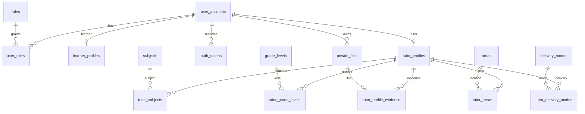
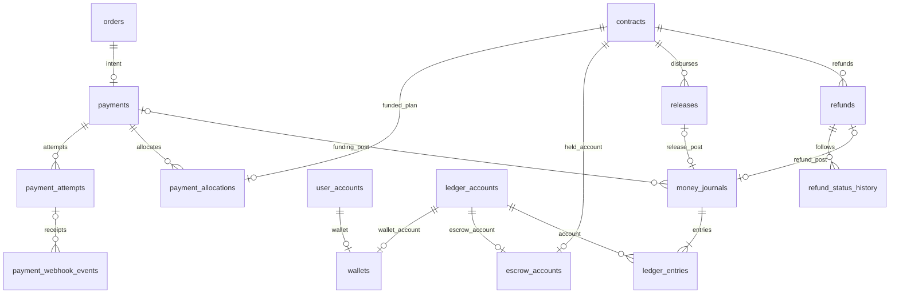
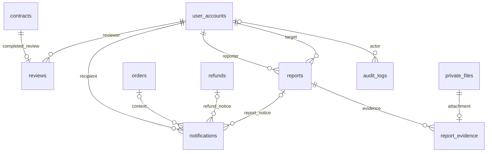

# Lược đồ database Educonnect

Bản SQL dự thảo cụ thể để nhóm review, ngày 11/10/2026. Các Q01–Q10 chưa có phê duyệt nghiệp vụ mới được đánh dấu **ĐỀ XUẤT – CHƯA CHỐT** tại DECISIONS.md. Chuỗi DDL canonical duy nhất: `src/main/resources/db/migration/V1__educonnect_schema.sql` + `V3__require_group_capacity_and_dates.sql`; dữ liệu tham chiếu V2; seed DEMO nằm ngoài Flyway. Không có bộ DDL thứ hai tại database/01_schema.sql.

## 1. Quy ước và cách truy cập

- MySQL Server **8.0.16 trở lên trong nhánh 8.0**, InnoDB/utf8mb4. CHECK được thực thi từ 8.0.16. MySQL Workbench và Navicat là client dùng cùng schema/SQL; phải đọc SELECT VERSION() để biết phiên bản server.
- Khóa entity **BIGINT signed**, Java `Long`; `@GeneratedValue(strategy=IDENTITY)`. Không dùng unsigned BIGINT vượt Long. Các junction PK composite dùng `@EmbeddedId`/`@MapsId`; role là code ASCII.
- Tiền **DECIMAL(19,0), VND nguyên đồng**; Java BigDecimal. Không FLOAT/DOUBLE. Rate **DECIMAL(9,6)** (0..1). Phí = ROUND(gross × rate,0), HALF_UP, net = gross − fee; snapshot rate/policy_version/rounding_mode cho sự kiện. Không DEFAULT 8%/10% trong schema.
- DATETIME(6) lưu **UTC**, không tự chuyển timezone như TIMESTAMP. JDBC connectionTimeZone=UTC, forceConnectionTimeZoneToSession=true; Hibernate jdbc.time_zone=UTC. Java dùng Instant hoặc LocalDateTime với hợp đồng UTC rõ ràng. DATE/TIME lịch lớp là giờ địa phương + IANA time_zone; không gộp thành UTC trước khi có ngày.
- Collation text **utf8mb4_0900_ai_ci**: tìm tên tiếng Việt không phân biệt dấu/chữ hoa. Vì “Hoa”/“Hòa” có thể so sánh bằng nhau, không dùng tên làm UNIQUE. Email ASCII đã trim/lowercase, ascii_general_ci UNIQUE; code/hash ASCII binary hoặc BINARY(32), không áp collation tìm kiếm cho token/secret.
- State là **VARCHAR ASCII + CHECK**, không MySQL ENUM; dễ đổi bằng migration, Java `@Enumerated(STRING)`, không ordinal. Các status code hiện là hợp đồng dự thảo; đổi code phải migration cả data/check/service.
- Cột version dùng JPA @Version và UPDATE ... WHERE id=? AND version=?; version không thay lock cho tổng tiền/sức chứa.
- Mọi FK dùng **RESTRICT**, không cascade xóa lịch sử giao dịch. Khóa tài khoản = LOCKED/DISABLED; xóa/anonymize theo retention policy riêng. Không hard-delete account có giao dịch.
- JSON chỉ có audit_logs.metadata, là metadata safe allowlist; nguồn đăng ký, item, money, file ownership đều FK thực. Không lưu danh sách ID dạng chuỗi.
- Không có JPA entity/repository production hiện tại. `application-db-dev.yml` đặt Hibernate validate, Flyway quản schema, SQL init never. `database/tools/DatabaseTool.java` là công cụ độc lập, không là backend nghiệp vụ.

## 2. Nhóm bảng và cardinality

51 bảng (bao gồm danh mục/junction/history/dev marker) và 4 view. Bảng tách theo mục đích; không phải mỗi BB/TC một bảng.

### Tài khoản, hồ sơ và minh chứng



LEARNER có learner_kind SELF/PARENT; không nhiều hồ sơ học sinh phụ huynh. PasswordEncoder đề xuất DelegatingPasswordEncoder/{bcrypt}; project chưa có bean tùy chỉnh. Token chỉ hash SHA-256 của token SecureRandom entropy cao, có expires/used/revoked. Hash password là BCrypt, không SHA-256 password. Logout dùng invalidate HttpSession/server security; không tạo bảng session khi project chưa dùng Spring Session. authentication_version phục vụ thu hồi phiên khi đổi mật khẩu, service cần so sánh stamp.

Minh chứng chỉ metadata/private storage key. Chủ tệp, mục đích và bảng liên kết rõ; service phải kiểm uploader/owner/admin và cấp URL ngắn hạn nếu có storage, không public src thẳng.

### Danh mục, nguồn đăng ký và giao dịch

```mermaid
erDiagram
  tutor_profiles ||--o{ offerings : provides
  offerings ||--o{ offering_time_slots : schedule
  learner_profiles ||--o| carts : cart
  carts ||--o{ cart_items : contains
  offerings ||--o{ cart_items : references
  learner_profiles ||--o{ invitations : invites
  tutor_profiles ||--o{ invitations : receives
  learner_profiles ||--o{ job_posts : posts
  job_posts ||--o{ job_applications : applications
  tutor_profiles ||--o{ job_applications : applies
  job_posts ||--o| job_selections : selects
  job_applications ||--o| job_selections : selected
  invitations o|--o| registration_sources : invitation_source
  job_selections o|--o| registration_sources : job_source
  offerings o|--o{ registration_sources : catalog_source
  learner_profiles ||--o{ orders : buys
  orders ||--|{ order_items : lines
  registration_sources ||--o| order_items : origin
  order_items ||--o| contracts : agreement
  contracts ||--o| enrollments : group_only
  offerings ||--o{ enrollments : class
  orders ||--o{ order_status_history : transitions
  contracts ||--o{ contract_status_history : transitions
```

- **Offering** là gói SERVICE hoặc GROUP_CLASS được chào bán. Giá/terms hiện hành có thể đổi; không sửa snapshot giao dịch cũ.
- **Cart** chưa là giao dịch; không giữ giá tin cậy. SERVICE seat_count=1; GROUP_CLASS seats>0. Checkout tính lại giá/availability/version.
- **RegistrationSource** có source_kind và FK có điều kiện. INVITATION dùng invitation_id UNIQUE; JOB_APPLICATION dùng job/application/tutor FK tới selection; CATALOG bắt buộc offering_id. Không có channel “INVITATION” giả cho dịch vụ mua từ giỏ.
- **Order** là tổng đơn của người mua, **không có tutor_id chung**: một đơn có thể nhiều tutor. Tổng phải bằng Σ item, service kiểm trong transaction.
- **OrderItem** giữ source, tutor, title/type/price/session/seats/fee/terms/hash snapshot. Một source dùng một item, FK/UNIQUE chống dùng lại invitation/selection. Repeat CATALOG tạo source mới.
- **Contract** tối đa một mỗi item, không một mỗi order. Dự thảo chỉ tạo contract sau khi hai bên đã đồng ý cùng hash terms; CATALOG publication là chấp thuận offer của tutor, người học chấp thuận khi place order. Nếu cần chờ từng bên confirm sau place order, xem Q03: migration nullable acceptance/status mới.
- **Enrollment** chỉ lớp nhóm, một contract một enrollment; seat_count có thể >1 nhưng không tạo học sinh riêng. Database không tự kiểm offering_type hoặc tổng chỗ bằng FK.
- Cardinality bắt buộc “order có ít nhất một item” và “sau checkout mỗi item có contract/source” được service tạo nguyên tử, không được FK tự bắt từ phía parent.
- Order/cancellation là toàn đơn ở đề xuất tối thiểu; contract/refund tính từng item. Hủy order nhiều item chỉ kết thúc khi mọi child xử lý xong; chưa có workflow hủy riêng từng item.

### Thanh toán và tiền



Payment intent có một order, wallet_amount + provider_amount = amount. Retry PayOS tạo attempt riêng, attempt_number/request_key/provider_order_code/provider_reference chống lặp. PayOS orderCode là BIGINT; return URL không xác nhận tiền. Webhook event UNIQUE(provider,event_key), signature_verified chỉ backend verifier ghi, digest không thay signature validation.

Allocation là **kế hoạch phân bổ** mỗi contract, không tiền đã nhận. Sau xác minh: journal WALLET_PAYMENT ghi debit ví learner/credit escrow; PROVIDER_PAYMENT debit clearing/credit escrow. Ví và escrow có ledger account riêng. Các balance view dẫn xuất sum CREDIT−DEBIT; clearing là tài khoản đối ứng có thể âm, không hiển thị như ví chi tiêu.

Release tạo debit escrow gross, credit tutor wallet net, credit PLATFORM_REVENUE fee. Revenue chỉ release có journal thật (v_tutor_revenue); held/planned không là revenue. MANUAL_MILESTONE chỉ giải ngân thủ công cơ bản, không lesson/session scheduler BS.

Refund yêu cầu có basis/rate/policy/destination snapshot; REQUESTED/PROCESSING/FAILED chưa post. SUCCEEDED tạo debit escrow/credit ví learner hoặc clearing trả provider. Pending generated UNIQUE hạn chế hai request pending cùng contract, **không** giải quyết cạnh tranh release/refund. Không clawback tiền đã release trong đề xuất tối thiểu. Phần không hoàn phải được disposition rõ trước đóng, không treo tiền vô danh.

Journal có business_key UNIQUE, release/refund mỗi cái tối đa một journal; entries dương và DEBIT/CREDIT. **Tổng debit=credit**, đúng account/owner/amount, tiền không âm và journal immutable là trách nhiệm service + transaction + verify, không CHECK từng dòng tự đảm bảo.

### Đánh giá và quản trị



Review gắn contract/item, UNIQUE một review mỗi contract. Service kiểm COMPLETED, đúng buyer, có thanh toán xác minh, không fully-refunded theo đề xuất Q09. Report chỉ target account (tutor cũng là account), có contract context tùy chọn; không dùng target_id polymorphic mất FK. Nếu cần report offering/job trong tương lai, migration typed relations sau phê duyệt.

Audit metadata không password/hash mật khẩu/token/credential/provider payload/giấy tờ. Notification cơ bản có FK context và event_key chống lặp, không tự gửi mail. dev_seed_runs là marker development, không phục vụ nghiệp vụ production.

## 3. Database bảo vệ và service phải làm

| Trường hợp | Database đã bảo vệ | Service/transaction bắt buộc |
| --- | --- | --- |
| Chọn trùng ứng viên | job_selections PK(job_id), UNIQUE(application_id), composite FK ứng viên đúng tin/tutor | Lock job, kiểm chủ tin/status/selectable, cập nhật losers/source/order cùng transaction |
| Tạo order lặp | UNIQUE learner_id/creation_key; idempotency scope/actor/key; source/item unique | So request_hash, trả cùng kết quả; retry sau crash; không chỉ bắt duplicate rồi báo success |
| Chỗ cuối lớp | FK enrollment, seat_count>0, UNIQUE contract | Lock offerings theo ID tăng dần; tính RESERVED còn hạn + CONFIRMED/COMPLETED; CHECK không SUM bảng khác |
| Webhook lặp | UNIQUE event, reference/request keys, journal business_key | Xác minh signature/amount/provider/account, lock intent, xử lý late/fail; ghi nhận receipt và post nguyên tử |
| Release/refund đồng thời | UNIQUE event/request; CHECK gross=fee+net; pending refund key | Lock escrow ledger account + contract/payment; tính available từ ledger đã post; không âm; thứ tự lock ổn định |
| Review chưa đủ điều kiện | FK contract, rating1..5, UNIQUE contract | Buyer/paid/completed/refund eligibility liên bảng; DB probe chứng minh insert có thể được chấp nhận nếu bỏ service |
| Transition sai | Status CHECK; order history FK tới transition matrix | Current state/version/role/owner; UPDATE CAS + history cùng transaction; direct UPDATE order có thể bypass history |
| Đọc data người khác | FK quan hệ sở hữu tồn tại | Principal/query scope, admin/tutor permissions, private evidence URL; không tin role/userId từ browser |
| Snapshot/history immutable | Snapshot tách khỏi offering; RESTRICT delete, money checks | Không UPDATE snapshot/journal đã post; cấp DB grant/service API phù hợp; correction qua reversal/migration, không sửa ledger lịch sử |
| Rerun seed | Marker checksum, stable PK và so toàn bộ fixture fields | Tắt writers; seed mutex chỉ serialize seed, không lock toàn ứng dụng; fixture changed phải dừng |

Transaction pattern: validate auth → lock parent (job/offering/order) theo thứ tự ID → lock ledger accounts theo ID → kiểm state/version/capacity/balance → insert/update tất cả domain+journal+history+notice → commit. Nếu conflict/deadlock, rollback/retry với cùng idempotency key. Không gọi provider giữ DB transaction mở lâu; request out-of-transaction có attempt rồi webhook xác minh/post.

## 4. Các đường đi mẫu

1. **Lời mời** DEMO-INV-1 → registration_sources INVITATION → DEMO-ORDER-01/item5001 → contract6001 → payment10001/PayOS attempt15001 (ví một phần) → escrow16001 → release28001 → tutor/fee; review27001.
2. **Tin/ứng viên** DEMO-JOB-14 → application14014/job_selection13014 → order9014/item5014/contract6014 → provider intent10014 → release thủ công 40% → refund29014 phần còn lại về ORIGINAL_PROVIDER. Không có buổi tự giải ngân.
3. **Danh mục/giỏ** DEMO-ORDER-18 có hai item5018/5019; contract6018/6019 thuộc hai tutor, payment chung phân bổ riêng. Đổi giá offering không đổi hai snapshots.
4. **Lớp đầy** offering2013/DEMO-OF-13 có hai enrollment confirmed, capacity2. Cart của learner302 tham chiếu lớp này để thử lỗi hết chỗ, không mặc nhiên checkout thành công.
5. **Lỗi hoàn** order9016/contract6016 refund FAILED; tiền vẫn escrow. status hủy là CANCELLATION_PENDING, không được báo tiền đã về ví.

## 5. Data dictionary toàn bộ cột

SQL COMMENT cũng chứa ý nghĩa tiếng Việt. Cột “Ràng buộc” liệt kê PK/FK/UNIQUE theo cột; CHECK/index cấp bảng nằm ngay sau bảng cột. Không suy constraint liên bảng từ FK.

### roles

Vai trò hệ thống; người học/phụ huynh dùng cùng LEARNER.

| Cột | SQL type/specification | NULL / default | Ràng buộc | Ý nghĩa |
| --- | --- | --- | --- | --- |
| `code` | `VARCHAR(24) CHARACTER SET ascii COLLATE ascii_bin NOT NULL` | NOT NULL; default không | PRIMARY KEY (code) | Mã ổn định, so sánh phân biệt hoa thường. |
| `label` | `VARCHAR(100) NOT NULL` | NOT NULL; default không | — | Tên vai trò tiếng Việt. |

Ràng buộc/index cấp bảng:


### subjects

Môn học dùng để lọc.

| Cột | SQL type/specification | NULL / default | Ràng buộc | Ý nghĩa |
| --- | --- | --- | --- | --- |
| `id` | `BIGINT NOT NULL AUTO_INCREMENT` | NOT NULL; default không | PRIMARY KEY (id) | Khóa kỹ thuật; ánh xạ Java Long. |
| `code` | `VARCHAR(64) CHARACTER SET ascii COLLATE ascii_bin NOT NULL` | NOT NULL; default không | uq_subjects_code UNIQUE (code) | Mã ổn định, so sánh phân biệt hoa thường. |
| `name` | `VARCHAR(120) NOT NULL` | NOT NULL; default không | — | Tên hiển thị tiếng Việt. |

Ràng buộc/index cấp bảng:


### grade_levels

Cấp/lớp học.

| Cột | SQL type/specification | NULL / default | Ràng buộc | Ý nghĩa |
| --- | --- | --- | --- | --- |
| `id` | `BIGINT NOT NULL AUTO_INCREMENT` | NOT NULL; default không | PRIMARY KEY (id) | Khóa kỹ thuật; ánh xạ Java Long. |
| `code` | `VARCHAR(64) CHARACTER SET ascii COLLATE ascii_bin NOT NULL` | NOT NULL; default không | uq_grade_levels_code UNIQUE (code) | Mã ổn định, so sánh phân biệt hoa thường. |
| `name` | `VARCHAR(120) NOT NULL` | NOT NULL; default không | — | Tên hiển thị tiếng Việt. |

Ràng buộc/index cấp bảng:


### areas

Khu vực giảng dạy.

| Cột | SQL type/specification | NULL / default | Ràng buộc | Ý nghĩa |
| --- | --- | --- | --- | --- |
| `id` | `BIGINT NOT NULL AUTO_INCREMENT` | NOT NULL; default không | PRIMARY KEY (id) | Khóa kỹ thuật; ánh xạ Java Long. |
| `code` | `VARCHAR(64) CHARACTER SET ascii COLLATE ascii_bin NOT NULL` | NOT NULL; default không | uq_areas_code UNIQUE (code) | Mã ổn định, so sánh phân biệt hoa thường. |
| `name` | `VARCHAR(120) NOT NULL` | NOT NULL; default không | — | Tên hiển thị tiếng Việt. |

Ràng buộc/index cấp bảng:


### delivery_modes

Hình thức học.

| Cột | SQL type/specification | NULL / default | Ràng buộc | Ý nghĩa |
| --- | --- | --- | --- | --- |
| `id` | `BIGINT NOT NULL AUTO_INCREMENT` | NOT NULL; default không | PRIMARY KEY (id) | Khóa kỹ thuật; ánh xạ Java Long. |
| `code` | `VARCHAR(64) CHARACTER SET ascii COLLATE ascii_bin NOT NULL` | NOT NULL; default không | uq_delivery_modes_code UNIQUE (code) | Mã ổn định, so sánh phân biệt hoa thường. |
| `name` | `VARCHAR(120) NOT NULL` | NOT NULL; default không | — | Tên hiển thị tiếng Việt. |

Ràng buộc/index cấp bảng:


### user_accounts

Tài khoản; khóa mềm giữ nguyên lịch sử giao dịch.

| Cột | SQL type/specification | NULL / default | Ràng buộc | Ý nghĩa |
| --- | --- | --- | --- | --- |
| `id` | `BIGINT NOT NULL AUTO_INCREMENT` | NOT NULL; default không | PRIMARY KEY (id) | Khóa kỹ thuật; ánh xạ Java Long. |
| `public_code` | `VARCHAR(64) CHARACTER SET ascii COLLATE ascii_bin NOT NULL` | NOT NULL; default không | uq_users_code UNIQUE (public_code) | Mã ổn định, so sánh phân biệt hoa thường. |
| `email` | `VARCHAR(254) CHARACTER SET ascii COLLATE ascii_general_ci NOT NULL` | NOT NULL; default không | uq_users_email UNIQUE (email) | Email ASCII đã trim/lowercase, không trùng khi đổi chữ hoa. |
| `password_hash` | `VARCHAR(255) CHARACTER SET ascii COLLATE ascii_bin NOT NULL` | NOT NULL; default không | — | DelegatingPasswordEncoder; {bcrypt} + hash BCrypt thật. |
| `status` | `VARCHAR(32) CHARACTER SET ascii COLLATE ascii_bin NOT NULL` | NOT NULL; default không | — | Trạng thái: ACTIVE, LOCKED, DISABLED. |
| `email_verified_at` | `DATETIME(6) NULL` | NULL; default không | — | NULL nếu email chưa được xác minh. |
| `display_name` | `VARCHAR(120) NOT NULL` | NOT NULL; default không | — | Tên giả lập hoặc tên hiển thị. |
| `phone` | `VARCHAR(24) NULL` | NULL; default không | — | Liên hệ tùy chọn; không dùng làm login. |
| `bio` | `TEXT NULL` | NULL; default không | — | Giới thiệu cá nhân. |
| `authentication_version` | `BIGINT NOT NULL DEFAULT 0` | NOT NULL; default 0 | — | Service tăng khi đổi mật khẩu/thu hồi phiên; session so sánh stamp. |
| `version` | `BIGINT NOT NULL DEFAULT 0` | NOT NULL; default 0 | — | Khóa lạc quan JPA @Version, cập nhật CAS tại service. |
| `created_at` | `DATETIME(6) NOT NULL` | NOT NULL; default không | — | Thời điểm UTC; không dùng múi giờ session để thay ý nghĩa. |
| `updated_at` | `DATETIME(6) NOT NULL` | NOT NULL; default không | — | Thời điểm UTC; không dùng múi giờ session để thay ý nghĩa. |

Ràng buộc/index cấp bảng:

- `CONSTRAINT ck_users_status CHECK (status IN ('ACTIVE', 'LOCKED', 'DISABLED'))`
- `CONSTRAINT ck_users_email_normalized CHECK (BINARY email = BINARY LOWER(TRIM(email)))`
- `CONSTRAINT ck_users_version CHECK (version >= 0 AND authentication_version >= 0)`

### user_roles

Quan hệ nhiều vai trò; không tự cấp role từ request.

| Cột | SQL type/specification | NULL / default | Ràng buộc | Ý nghĩa |
| --- | --- | --- | --- | --- |
| `user_id` | `BIGINT NOT NULL` | NOT NULL; default không | PRIMARY KEY (user_id, role_code)<br>fk_ur_user FOREIGN KEY (user_id) REFERENCES user_accounts (id) | Tài khoản. |
| `role_code` | `VARCHAR(24) CHARACTER SET ascii COLLATE ascii_bin NOT NULL` | NOT NULL; default không | PRIMARY KEY (user_id, role_code)<br>fk_ur_role FOREIGN KEY (role_code) REFERENCES roles (code) | Mã ổn định, so sánh phân biệt hoa thường. |

Ràng buộc/index cấp bảng:


### learner_profiles

Một hồ sơ người học hoặc phụ huynh; không có nhiều hồ sơ học sinh BS.

| Cột | SQL type/specification | NULL / default | Ràng buộc | Ý nghĩa |
| --- | --- | --- | --- | --- |
| `user_id` | `BIGINT NOT NULL` | NOT NULL; default không | PRIMARY KEY (user_id)<br>fk_lp_user FOREIGN KEY (user_id) REFERENCES user_accounts (id) | Account đóng vai trò người mua. |
| `learner_kind` | `VARCHAR(32) CHARACTER SET ascii COLLATE ascii_bin NOT NULL` | NOT NULL; default không | — | Trạng thái: SELF, PARENT. |
| `grade_level_id` | `BIGINT NULL` | NULL; default không | fk_lp_grade FOREIGN KEY (grade_level_id) REFERENCES grade_levels (id) | Cấp học mặc định để tìm kiếm. |
| `area_id` | `BIGINT NULL` | NULL; default không | fk_lp_area FOREIGN KEY (area_id) REFERENCES areas (id) | Khu vực mặc định. |

Ràng buộc/index cấp bảng:

- `CONSTRAINT ck_lp_kind CHECK (learner_kind IN ('SELF','PARENT'))`

### tutor_profiles

Hồ sơ chuyên môn và trạng thái duyệt gia sư.

| Cột | SQL type/specification | NULL / default | Ràng buộc | Ý nghĩa |
| --- | --- | --- | --- | --- |
| `user_id` | `BIGINT NOT NULL` | NOT NULL; default không | PRIMARY KEY (user_id)<br>fk_tp_user FOREIGN KEY (user_id) REFERENCES user_accounts (id) | Account gia sư. |
| `review_status` | `VARCHAR(32) CHARACTER SET ascii COLLATE ascii_bin NOT NULL` | NOT NULL; default không | — | Trạng thái: DRAFT, PENDING, APPROVED, REJECTED. |
| `headline` | `VARCHAR(180) NOT NULL` | NOT NULL; default không | — | Tiêu đề hồ sơ. |
| `experience_years` | `SMALLINT NOT NULL` | NOT NULL; default không | — | Số năm kinh nghiệm. |
| `reviewed_by` | `BIGINT NULL` | NULL; default không | fk_tp_reviewer FOREIGN KEY (reviewed_by) REFERENCES user_accounts (id) | Admin duyệt, service kiểm role. |
| `reviewed_at` | `DATETIME(6) NULL` | NULL; default không | — | Thời điểm quyết định. |
| `review_note` | `TEXT NULL` | NULL; default không | — | Lý do từ chối/ghi chú riêng tư. |
| `version` | `BIGINT NOT NULL DEFAULT 0` | NOT NULL; default 0 | — | Khóa lạc quan JPA @Version, cập nhật CAS tại service. |
| `updated_at` | `DATETIME(6) NOT NULL` | NOT NULL; default không | — | Thời điểm UTC; không dùng múi giờ session để thay ý nghĩa. |

Ràng buộc/index cấp bảng:

- `CONSTRAINT ck_tp_status CHECK (review_status IN ('DRAFT','PENDING','APPROVED','REJECTED'))`
- `CONSTRAINT ck_tp_experience CHECK (experience_years BETWEEN 0 AND 80)`
- `CONSTRAINT ck_tp_decision CHECK ((review_status IN ('APPROVED','REJECTED') AND reviewed_by IS NOT NULL AND reviewed_at IS NOT NULL) OR (review_status IN ('DRAFT','PENDING')))`

### tutor_subjects

Danh sách chuẩn hóa theo gia sư, không lưu ID dạng chuỗi.

| Cột | SQL type/specification | NULL / default | Ràng buộc | Ý nghĩa |
| --- | --- | --- | --- | --- |
| `tutor_id` | `BIGINT NOT NULL` | NOT NULL; default không | PRIMARY KEY (tutor_id, subject_id)<br>fk_tutor_subjects_tutor FOREIGN KEY (tutor_id) REFERENCES tutor_profiles (user_id) | Gia sư. |
| `subject_id` | `BIGINT NOT NULL` | NOT NULL; default không | PRIMARY KEY (tutor_id, subject_id)<br>fk_tutor_subjects_ref FOREIGN KEY (subject_id) REFERENCES subjects (id) | Giá trị danh mục. |

Ràng buộc/index cấp bảng:


### tutor_grade_levels

Danh sách chuẩn hóa theo gia sư, không lưu ID dạng chuỗi.

| Cột | SQL type/specification | NULL / default | Ràng buộc | Ý nghĩa |
| --- | --- | --- | --- | --- |
| `tutor_id` | `BIGINT NOT NULL` | NOT NULL; default không | PRIMARY KEY (tutor_id, grade_level_id)<br>fk_tutor_grade_levels_tutor FOREIGN KEY (tutor_id) REFERENCES tutor_profiles (user_id) | Gia sư. |
| `grade_level_id` | `BIGINT NOT NULL` | NOT NULL; default không | PRIMARY KEY (tutor_id, grade_level_id)<br>fk_tutor_grade_levels_ref FOREIGN KEY (grade_level_id) REFERENCES grade_levels (id) | Giá trị danh mục. |

Ràng buộc/index cấp bảng:


### tutor_areas

Danh sách chuẩn hóa theo gia sư, không lưu ID dạng chuỗi.

| Cột | SQL type/specification | NULL / default | Ràng buộc | Ý nghĩa |
| --- | --- | --- | --- | --- |
| `tutor_id` | `BIGINT NOT NULL` | NOT NULL; default không | PRIMARY KEY (tutor_id, area_id)<br>fk_tutor_areas_tutor FOREIGN KEY (tutor_id) REFERENCES tutor_profiles (user_id) | Gia sư. |
| `area_id` | `BIGINT NOT NULL` | NOT NULL; default không | PRIMARY KEY (tutor_id, area_id)<br>fk_tutor_areas_ref FOREIGN KEY (area_id) REFERENCES areas (id) | Giá trị danh mục. |

Ràng buộc/index cấp bảng:


### tutor_delivery_modes

Danh sách chuẩn hóa theo gia sư, không lưu ID dạng chuỗi.

| Cột | SQL type/specification | NULL / default | Ràng buộc | Ý nghĩa |
| --- | --- | --- | --- | --- |
| `tutor_id` | `BIGINT NOT NULL` | NOT NULL; default không | PRIMARY KEY (tutor_id, delivery_mode_id)<br>fk_tutor_delivery_modes_tutor FOREIGN KEY (tutor_id) REFERENCES tutor_profiles (user_id) | Gia sư. |
| `delivery_mode_id` | `BIGINT NOT NULL` | NOT NULL; default không | PRIMARY KEY (tutor_id, delivery_mode_id)<br>fk_tutor_delivery_modes_ref FOREIGN KEY (delivery_mode_id) REFERENCES delivery_modes (id) | Giá trị danh mục. |

Ràng buộc/index cấp bảng:


### private_files

Metadata tệp riêng tư; storage_key không phải public URL hay secret.

| Cột | SQL type/specification | NULL / default | Ràng buộc | Ý nghĩa |
| --- | --- | --- | --- | --- |
| `id` | `BIGINT NOT NULL AUTO_INCREMENT` | NOT NULL; default không | PRIMARY KEY (id) | Khóa kỹ thuật; ánh xạ Java Long. |
| `owner_user_id` | `BIGINT NOT NULL` | NOT NULL; default không | fk_files_owner FOREIGN KEY (owner_user_id) REFERENCES user_accounts (id) | Chủ tệp; service bảo vệ quyền đọc. |
| `storage_key` | `VARCHAR(160) CHARACTER SET ascii COLLATE ascii_bin NOT NULL` | NOT NULL; default không | uq_files_storage UNIQUE (storage_key) | Mã ổn định, so sánh phân biệt hoa thường. |
| `purpose` | `VARCHAR(32) CHARACTER SET ascii COLLATE ascii_bin NOT NULL` | NOT NULL; default không | — | Trạng thái: TUTOR_EVIDENCE, REPORT_EVIDENCE. |
| `original_name` | `VARCHAR(255) NOT NULL` | NOT NULL; default không | — | Tên tệp đã được service kiểm/sanitize. |
| `mime_type` | `VARCHAR(80) CHARACTER SET ascii COLLATE ascii_bin NOT NULL` | NOT NULL; default không | — | Mã ổn định, so sánh phân biệt hoa thường. |
| `byte_size` | `BIGINT NOT NULL` | NOT NULL; default không | — | Dung lượng dương. |
| `sha256` | `BINARY(32) NOT NULL` | NOT NULL; default không | — | SHA-256 nội dung, không phải nội dung tệp. |
| `created_at` | `DATETIME(6) NOT NULL` | NOT NULL; default không | — | Thời điểm UTC; không dùng múi giờ session để thay ý nghĩa. |

Ràng buộc/index cấp bảng:

- `CONSTRAINT ck_files_purpose CHECK (purpose IN ('TUTOR_EVIDENCE','REPORT_EVIDENCE'))`
- `CONSTRAINT ck_files_size CHECK (byte_size > 0)`

### tutor_profile_evidence

Tệp minh chứng gắn hồ sơ gia sư.

| Cột | SQL type/specification | NULL / default | Ràng buộc | Ý nghĩa |
| --- | --- | --- | --- | --- |
| `tutor_id` | `BIGINT NOT NULL` | NOT NULL; default không | PRIMARY KEY (tutor_id, file_id)<br>fk_tpe_tutor FOREIGN KEY (tutor_id) REFERENCES tutor_profiles (user_id) | Hồ sơ. |
| `file_id` | `BIGINT NOT NULL` | NOT NULL; default không | PRIMARY KEY (tutor_id, file_id)<br>uq_tpe_file UNIQUE (file_id)<br>fk_tpe_file FOREIGN KEY (file_id) REFERENCES private_files (id) | Minh chứng riêng tư. |

Ràng buộc/index cấp bảng:


### auth_tokens

Token xác minh/reset chỉ lưu SHA-256, không lưu token thô.

| Cột | SQL type/specification | NULL / default | Ràng buộc | Ý nghĩa |
| --- | --- | --- | --- | --- |
| `id` | `BIGINT NOT NULL AUTO_INCREMENT` | NOT NULL; default không | PRIMARY KEY (id) | Khóa kỹ thuật; ánh xạ Java Long. |
| `user_id` | `BIGINT NOT NULL` | NOT NULL; default không | fk_tokens_user FOREIGN KEY (user_id) REFERENCES user_accounts (id) | Tài khoản nhận token. |
| `purpose` | `VARCHAR(32) CHARACTER SET ascii COLLATE ascii_bin NOT NULL` | NOT NULL; default không | — | Trạng thái: VERIFY_EMAIL, RESET_PASSWORD. |
| `token_hash` | `BINARY(32) NOT NULL` | NOT NULL; default không | uq_tokens_hash UNIQUE (token_hash) | Hash của token ngẫu nhiên entropy cao. |
| `created_at` | `DATETIME(6) NOT NULL` | NOT NULL; default không | — | Thời điểm UTC; không dùng múi giờ session để thay ý nghĩa. |
| `expires_at` | `DATETIME(6) NOT NULL` | NOT NULL; default không | — | Thời điểm UTC; không dùng múi giờ session để thay ý nghĩa. |
| `used_at` | `DATETIME(6) NULL` | NULL; default không | — | Thời điểm sử dụng một lần. |
| `revoked_at` | `DATETIME(6) NULL` | NULL; default không | — | Thu hồi chủ động. |

Ràng buộc/index cấp bảng:

- `CONSTRAINT ck_tokens_purpose CHECK (purpose IN ('VERIFY_EMAIL','RESET_PASSWORD'))`
- `CONSTRAINT ck_tokens_time CHECK (expires_at > created_at AND (used_at IS NULL OR used_at >= created_at) AND (revoked_at IS NULL OR revoked_at >= created_at))`
- `INDEX ix_tokens_user_expiry (user_id, purpose, expires_at)`

### offerings

Dịch vụ/lớp do gia sư cung cấp; không là order/contract.

| Cột | SQL type/specification | NULL / default | Ràng buộc | Ý nghĩa |
| --- | --- | --- | --- | --- |
| `id` | `BIGINT NOT NULL AUTO_INCREMENT` | NOT NULL; default không | PRIMARY KEY (id)<br>uq_off_owner UNIQUE (id, tutor_id) | Khóa kỹ thuật; ánh xạ Java Long. |
| `public_code` | `VARCHAR(64) CHARACTER SET ascii COLLATE ascii_bin NOT NULL` | NOT NULL; default không | uq_off_code UNIQUE (public_code) | Mã ổn định, so sánh phân biệt hoa thường. |
| `tutor_id` | `BIGINT NOT NULL` | NOT NULL; default không | uq_off_owner UNIQUE (id, tutor_id)<br>fk_off_tutor FOREIGN KEY (tutor_id) REFERENCES tutor_profiles (user_id) | Chủ dịch vụ/lớp. |
| `offering_type` | `VARCHAR(32) CHARACTER SET ascii COLLATE ascii_bin NOT NULL` | NOT NULL; default không | — | Trạng thái: SERVICE, GROUP_CLASS. |
| `title` | `VARCHAR(220) NOT NULL` | NOT NULL; default không | — | Tên dịch vụ/lớp. |
| `description` | `TEXT NOT NULL` | NOT NULL; default không | — | Mô tả công khai. |
| `subject_id` | `BIGINT NOT NULL` | NOT NULL; default không | fk_off_subject FOREIGN KEY (subject_id) REFERENCES subjects (id) | Môn học. |
| `grade_level_id` | `BIGINT NOT NULL` | NOT NULL; default không | fk_off_grade FOREIGN KEY (grade_level_id) REFERENCES grade_levels (id) | Cấp/lớp. |
| `area_id` | `BIGINT NOT NULL` | NOT NULL; default không | fk_off_area FOREIGN KEY (area_id) REFERENCES areas (id) | Khu vực. |
| `delivery_mode_id` | `BIGINT NOT NULL` | NOT NULL; default không | fk_off_mode FOREIGN KEY (delivery_mode_id) REFERENCES delivery_modes (id) | Hình thức học. |
| `unit_price` | `DECIMAL(19,0) NOT NULL` | NOT NULL; default không | — | Số tiền VND nguyên đồng; Java BigDecimal, không float. |
| `currency` | `CHAR(3) CHARACTER SET ascii COLLATE ascii_bin NOT NULL DEFAULT 'VND'` | NOT NULL; default 'VND' | — | Đồng tiền; V1 chỉ hỗ trợ VND. |
| `session_count` | `SMALLINT NOT NULL` | NOT NULL; default không | — | Số buổi trong gói, không tự động giải ngân mỗi buổi. |
| `duration_minutes` | `SMALLINT NOT NULL` | NOT NULL; default không | — | Thời lượng buổi. |
| `capacity` | `INT NULL` | NULL; default không | — | Chỉ GROUP_CLASS có sức chứa. |
| `starts_on` | `DATE NULL` | NULL; default không | — | Ngày bắt đầu lớp theo timezone lịch. |
| `ends_on` | `DATE NULL` | NULL; default không | — | Ngày kết thúc lớp. |
| `status` | `VARCHAR(32) CHARACTER SET ascii COLLATE ascii_bin NOT NULL` | NOT NULL; default không | — | Trạng thái: DRAFT, IN_REVIEW, PUBLISHED, UNPUBLISHED, REJECTED, CLOSED. |
| `first_published_at` | `DATETIME(6) NULL` | NULL; default không | — | Mốc công khai lần đầu; mặc định không đổi khi duyệt lại. |
| `published_at` | `DATETIME(6) NULL` | NULL; default không | — | Mốc phục vụ newest; đề xuất giữ lần đầu, Q10 chưa chốt. |
| `reviewed_by` | `BIGINT NULL` | NULL; default không | fk_off_reviewer FOREIGN KEY (reviewed_by) REFERENCES user_accounts (id) | Admin duyệt. |
| `reviewed_at` | `DATETIME(6) NULL` | NULL; default không | — | Mốc duyệt. |
| `review_note` | `TEXT NULL` | NULL; default không | — | Lý do/ghi chú. |
| `terms_version` | `INT NOT NULL` | NOT NULL; default không | — | Phiên bản điều khoản hiện hành, không có lịch sử đàm phán nhiều phiên bản. |
| `terms_text` | `TEXT NOT NULL` | NOT NULL; default không | — | Điều khoản hiện hành, snapshot khi tạo item. |
| `version` | `BIGINT NOT NULL DEFAULT 0` | NOT NULL; default 0 | — | Khóa lạc quan JPA @Version, cập nhật CAS tại service. |
| `created_at` | `DATETIME(6) NOT NULL` | NOT NULL; default không | — | Thời điểm UTC; không dùng múi giờ session để thay ý nghĩa. |
| `updated_at` | `DATETIME(6) NOT NULL` | NOT NULL; default không | — | Thời điểm UTC; không dùng múi giờ session để thay ý nghĩa. |

Ràng buộc/index cấp bảng:

- `CONSTRAINT ck_off_type CHECK (offering_type IN ('SERVICE','GROUP_CLASS'))`
- `CONSTRAINT ck_off_status CHECK (status IN ('DRAFT','IN_REVIEW','PUBLISHED','UNPUBLISHED','REJECTED','CLOSED'))`
- `CONSTRAINT ck_off_amount CHECK (unit_price > 0 AND currency = 'VND' AND session_count > 0 AND duration_minutes > 0 AND terms_version > 0)`
- `CONSTRAINT ck_off_capacity_present CHECK ((offering_type='SERVICE' AND capacity IS NULL) OR (offering_type='GROUP_CLASS' AND capacity IS NOT NULL AND capacity>0 AND starts_on IS NOT NULL AND ends_on IS NOT NULL AND ends_on>=starts_on))` (V3; CHECK UNKNOWN không kiểm trường bắt buộc)
- `CONSTRAINT ck_off_publication CHECK (status <> 'PUBLISHED' OR (published_at IS NOT NULL AND first_published_at IS NOT NULL AND reviewed_at IS NOT NULL AND reviewed_by IS NOT NULL))`
- `INDEX ix_off_latest (status, published_at, id)`
- `INDEX ix_off_filter (status, subject_id, grade_level_id, delivery_mode_id, unit_price)`
- `INDEX ix_off_tutor (tutor_id, status, id)`
- `INDEX ix_off_area (area_id, status)`

### offering_time_slots

Khung lịch cố định cơ bản; không workflow đổi lịch nâng cao.

| Cột | SQL type/specification | NULL / default | Ràng buộc | Ý nghĩa |
| --- | --- | --- | --- | --- |
| `id` | `BIGINT NOT NULL AUTO_INCREMENT` | NOT NULL; default không | PRIMARY KEY (id) | Khóa kỹ thuật; ánh xạ Java Long. |
| `offering_id` | `BIGINT NOT NULL` | NOT NULL; default không | fk_ots_offering FOREIGN KEY (offering_id) REFERENCES offerings (id)<br>uq_ots_slot UNIQUE (offering_id, weekday, start_time) | Dịch vụ/lớp. |
| `weekday` | `TINYINT NOT NULL` | NOT NULL; default không | uq_ots_slot UNIQUE (offering_id, weekday, start_time) | ISO thứ: 1 thứ Hai đến 7 Chủ nhật. |
| `start_time` | `TIME NOT NULL` | NOT NULL; default không | uq_ots_slot UNIQUE (offering_id, weekday, start_time) | Giờ địa phương. |
| `end_time` | `TIME NOT NULL` | NOT NULL; default không | — | Giờ địa phương, cùng ngày. |
| `time_zone` | `VARCHAR(64) CHARACTER SET ascii COLLATE ascii_bin NOT NULL` | NOT NULL; default không | — | IANA timezone, ví dụ Asia/Ho_Chi_Minh. |

Ràng buộc/index cấp bảng:

- `CONSTRAINT ck_ots_time CHECK (weekday BETWEEN 1 AND 7 AND start_time >= '00:00:00' AND end_time <= '23:59:59' AND end_time > start_time)`

### invitations

Lời mời với một bộ điều khoản hiện hành; không version negotiation BS.

| Cột | SQL type/specification | NULL / default | Ràng buộc | Ý nghĩa |
| --- | --- | --- | --- | --- |
| `id` | `BIGINT NOT NULL AUTO_INCREMENT` | NOT NULL; default không | PRIMARY KEY (id)<br>uq_inv_parties UNIQUE (id, learner_id, tutor_id) | Khóa kỹ thuật Java Long. |
| `public_code` | `VARCHAR(64) CHARACTER SET ascii COLLATE ascii_bin NOT NULL` | NOT NULL; default không | uq_inv_code UNIQUE (public_code) | Mã ổn định/khóa chống lặp. |
| `learner_id` | `BIGINT NOT NULL` | NOT NULL; default không | uq_inv_parties UNIQUE (id, learner_id, tutor_id)<br>fk_inv_learner FOREIGN KEY (learner_id) REFERENCES learner_profiles (user_id) | Người mời. |
| `tutor_id` | `BIGINT NOT NULL` | NOT NULL; default không | uq_inv_parties UNIQUE (id, learner_id, tutor_id)<br>fk_inv_tutor FOREIGN KEY (tutor_id) REFERENCES tutor_profiles (user_id)<br>fk_inv_offering FOREIGN KEY (offering_id, tutor_id) REFERENCES offerings (id, tutor_id) | Gia sư được mời. |
| `offering_id` | `BIGINT NULL` | NULL; default không | fk_inv_offering FOREIGN KEY (offering_id, tutor_id) REFERENCES offerings (id, tutor_id) | Dịch vụ tham khảo nếu có. |
| `subject_id` | `BIGINT NOT NULL` | NOT NULL; default không | fk_inv_subject FOREIGN KEY (subject_id) REFERENCES subjects (id) | Môn. |
| `grade_level_id` | `BIGINT NOT NULL` | NOT NULL; default không | fk_inv_grade FOREIGN KEY (grade_level_id) REFERENCES grade_levels (id) | Cấp. |
| `area_id` | `BIGINT NOT NULL` | NOT NULL; default không | fk_inv_area FOREIGN KEY (area_id) REFERENCES areas (id) | Khu vực. |
| `delivery_mode_id` | `BIGINT NOT NULL` | NOT NULL; default không | fk_inv_mode FOREIGN KEY (delivery_mode_id) REFERENCES delivery_modes (id) | Hình thức. |
| `proposed_unit_price` | `DECIMAL(19,0) NOT NULL` | NOT NULL; default không | — | VND nguyên đồng, Java BigDecimal. |
| `session_count` | `SMALLINT NOT NULL` | NOT NULL; default không | — | Số buổi đề nghị. |
| `terms_version` | `INT NOT NULL` | NOT NULL; default không | — | Phiên bản hiện hành để chống stale, không lưu lịch sử đàm phán. |
| `terms_text` | `TEXT NOT NULL` | NOT NULL; default không | — | Bộ điều khoản hiện hành. |
| `status` | `VARCHAR(32) CHARACTER SET ascii COLLATE ascii_bin NOT NULL` | NOT NULL; default không | — | Trạng thái: PENDING, ACCEPTED, DECLINED, CANCELLED, EXPIRED. |
| `accepted_at` | `DATETIME(6) NULL` | NULL; default không | — | Mốc cả hai bên chấp nhận bộ điều khoản hiện hành. |
| `version` | `BIGINT NOT NULL DEFAULT 0` | NOT NULL; default 0 | — | JPA @Version; service cập nhật CAS. |
| `created_at` | `DATETIME(6) NOT NULL` | NOT NULL; default không | — | Thời điểm UTC, độ chính xác microsecond. |
| `expires_at` | `DATETIME(6) NOT NULL` | NOT NULL; default không | — | Thời điểm UTC, độ chính xác microsecond. |

Ràng buộc/index cấp bảng:

- `CONSTRAINT ck_inv_status CHECK (status IN ('PENDING','ACCEPTED','DECLINED','CANCELLED','EXPIRED'))`
- `CONSTRAINT ck_inv_amount CHECK (proposed_unit_price > 0 AND session_count > 0 AND terms_version > 0)`
- `CONSTRAINT ck_inv_acceptance CHECK (status <> 'ACCEPTED' OR accepted_at IS NOT NULL)`
- `CONSTRAINT ck_inv_expiry CHECK (expires_at > created_at)`
- `INDEX ix_inv_owner (learner_id, status, created_at)`

### job_posts

Tin tìm gia sư cơ bản để truy vết nguồn đơn, không workflow BS.

| Cột | SQL type/specification | NULL / default | Ràng buộc | Ý nghĩa |
| --- | --- | --- | --- | --- |
| `id` | `BIGINT NOT NULL AUTO_INCREMENT` | NOT NULL; default không | PRIMARY KEY (id) | Khóa kỹ thuật Java Long. |
| `public_code` | `VARCHAR(64) CHARACTER SET ascii COLLATE ascii_bin NOT NULL` | NOT NULL; default không | uq_jobs_code UNIQUE (public_code) | Mã ổn định/khóa chống lặp. |
| `learner_id` | `BIGINT NOT NULL` | NOT NULL; default không | fk_jobs_learner FOREIGN KEY (learner_id) REFERENCES learner_profiles (user_id) | Người đăng tin. |
| `title` | `VARCHAR(220) NOT NULL` | NOT NULL; default không | — | Tiêu đề. |
| `description` | `TEXT NOT NULL` | NOT NULL; default không | — | Yêu cầu học. |
| `subject_id` | `BIGINT NOT NULL` | NOT NULL; default không | fk_jobs_subject FOREIGN KEY (subject_id) REFERENCES subjects (id) | Môn. |
| `grade_level_id` | `BIGINT NOT NULL` | NOT NULL; default không | fk_jobs_grade FOREIGN KEY (grade_level_id) REFERENCES grade_levels (id) | Cấp. |
| `area_id` | `BIGINT NOT NULL` | NOT NULL; default không | fk_jobs_area FOREIGN KEY (area_id) REFERENCES areas (id) | Khu vực. |
| `delivery_mode_id` | `BIGINT NOT NULL` | NOT NULL; default không | fk_jobs_mode FOREIGN KEY (delivery_mode_id) REFERENCES delivery_modes (id) | Hình thức. |
| `budget_per_session` | `DECIMAL(19,0) NOT NULL` | NOT NULL; default không | — | VND nguyên đồng, Java BigDecimal. |
| `session_count` | `SMALLINT NOT NULL` | NOT NULL; default không | — | Tổng buổi. |
| `status` | `VARCHAR(32) CHARACTER SET ascii COLLATE ascii_bin NOT NULL` | NOT NULL; default không | — | Trạng thái: DRAFT, PENDING, OPEN, MATCHED, CLOSED, REJECTED. |
| `version` | `BIGINT NOT NULL DEFAULT 0` | NOT NULL; default 0 | — | JPA @Version; service cập nhật CAS. |
| `created_at` | `DATETIME(6) NOT NULL` | NOT NULL; default không | — | Thời điểm UTC, độ chính xác microsecond. |

Ràng buộc/index cấp bảng:

- `CONSTRAINT ck_jobs_status CHECK (status IN ('DRAFT','PENDING','OPEN','MATCHED','CLOSED','REJECTED'))`
- `CONSTRAINT ck_jobs_amount CHECK (budget_per_session > 0 AND session_count > 0)`
- `INDEX ix_jobs_owner (learner_id, created_at)`

### job_applications

Một lượt ứng tuyển của một gia sư cho một tin.

| Cột | SQL type/specification | NULL / default | Ràng buộc | Ý nghĩa |
| --- | --- | --- | --- | --- |
| `id` | `BIGINT NOT NULL AUTO_INCREMENT` | NOT NULL; default không | PRIMARY KEY (id)<br>uq_apps_selection UNIQUE (job_id, id, tutor_id) | Khóa kỹ thuật Java Long. |
| `job_id` | `BIGINT NOT NULL` | NOT NULL; default không | uq_apps_tutor UNIQUE (job_id, tutor_id)<br>uq_apps_selection UNIQUE (job_id, id, tutor_id)<br>fk_apps_job FOREIGN KEY (job_id) REFERENCES job_posts (id) | Tin. |
| `tutor_id` | `BIGINT NOT NULL` | NOT NULL; default không | uq_apps_tutor UNIQUE (job_id, tutor_id)<br>uq_apps_selection UNIQUE (job_id, id, tutor_id)<br>fk_apps_tutor FOREIGN KEY (tutor_id) REFERENCES tutor_profiles (user_id) | Gia sư. |
| `proposed_unit_price` | `DECIMAL(19,0) NOT NULL` | NOT NULL; default không | — | VND nguyên đồng, Java BigDecimal. |
| `message` | `TEXT NOT NULL` | NOT NULL; default không | — | Lời giới thiệu. |
| `status` | `VARCHAR(32) CHARACTER SET ascii COLLATE ascii_bin NOT NULL` | NOT NULL; default không | — | Trạng thái: SUBMITTED, SELECTED, REJECTED, WITHDRAWN. |
| `version` | `BIGINT NOT NULL DEFAULT 0` | NOT NULL; default 0 | — | JPA @Version; service cập nhật CAS. |
| `created_at` | `DATETIME(6) NOT NULL` | NOT NULL; default không | — | Thời điểm UTC, độ chính xác microsecond. |

Ràng buộc/index cấp bảng:

- `CONSTRAINT ck_apps_status CHECK (status IN ('SUBMITTED','SELECTED','REJECTED','WITHDRAWN'))`
- `CONSTRAINT ck_apps_price CHECK (proposed_unit_price > 0)`

### job_selections

Một tin chỉ chọn một ứng viên; giữ điều khoản đã đồng ý.

| Cột | SQL type/specification | NULL / default | Ràng buộc | Ý nghĩa |
| --- | --- | --- | --- | --- |
| `job_id` | `BIGINT NOT NULL` | NOT NULL; default không | PRIMARY KEY (job_id)<br>uq_sel_source UNIQUE (job_id, application_id, tutor_id)<br>fk_sel_application FOREIGN KEY (job_id, application_id, tutor_id) REFERENCES job_applications (job_id, id, tutor_id) | PK bảo vệ chọn trùng tin. |
| `application_id` | `BIGINT NOT NULL` | NOT NULL; default không | uq_sel_app UNIQUE (application_id)<br>uq_sel_source UNIQUE (job_id, application_id, tutor_id)<br>fk_sel_application FOREIGN KEY (job_id, application_id, tutor_id) REFERENCES job_applications (job_id, id, tutor_id) | Ứng viên của đúng tin. |
| `tutor_id` | `BIGINT NOT NULL` | NOT NULL; default không | uq_sel_source UNIQUE (job_id, application_id, tutor_id)<br>fk_sel_application FOREIGN KEY (job_id, application_id, tutor_id) REFERENCES job_applications (job_id, id, tutor_id) | Gia sư ứng viên. |
| `selected_by` | `BIGINT NOT NULL` | NOT NULL; default không | fk_sel_actor FOREIGN KEY (selected_by) REFERENCES user_accounts (id) | Người chọn, service kiểm chủ tin. |
| `terms_version` | `INT NOT NULL` | NOT NULL; default không | — | Phiên bản được chấp thuận. |
| `terms_text` | `TEXT NOT NULL` | NOT NULL; default không | — | Điều khoản chọn hiện hành. |
| `selected_at` | `DATETIME(6) NOT NULL` | NOT NULL; default không | — | Thời điểm UTC, độ chính xác microsecond. |

Ràng buộc/index cấp bảng:

- `CONSTRAINT ck_sel_terms CHECK (terms_version > 0)`

### registration_sources

Nguồn đăng ký chuẩn hóa cho mỗi item; không gắn source qua JSON.

| Cột | SQL type/specification | NULL / default | Ràng buộc | Ý nghĩa |
| --- | --- | --- | --- | --- |
| `id` | `BIGINT NOT NULL AUTO_INCREMENT` | NOT NULL; default không | PRIMARY KEY (id) | Khóa kỹ thuật Java Long. |
| `source_kind` | `VARCHAR(32) CHARACTER SET ascii COLLATE ascii_bin NOT NULL` | NOT NULL; default không | — | Trạng thái: INVITATION, JOB_APPLICATION, CATALOG. |
| `learner_id` | `BIGINT NOT NULL` | NOT NULL; default không | fk_sources_learner FOREIGN KEY (learner_id) REFERENCES learner_profiles (user_id)<br>fk_sources_invitation FOREIGN KEY (invitation_id, learner_id, tutor_id) REFERENCES invitations (id, learner_id, tutor_id) | Người mua. |
| `tutor_id` | `BIGINT NOT NULL` | NOT NULL; default không | fk_sources_tutor FOREIGN KEY (tutor_id) REFERENCES tutor_profiles (user_id)<br>fk_sources_invitation FOREIGN KEY (invitation_id, learner_id, tutor_id) REFERENCES invitations (id, learner_id, tutor_id)<br>fk_sources_selection FOREIGN KEY (job_id, application_id, tutor_id) REFERENCES job_selections (job_id, application_id, tutor_id)<br>fk_sources_offering FOREIGN KEY (offering_id, tutor_id) REFERENCES offerings (id, tutor_id) | Gia sư. |
| `invitation_id` | `BIGINT NULL` | NULL; default không | uq_sources_invitation UNIQUE (invitation_id)<br>fk_sources_invitation FOREIGN KEY (invitation_id, learner_id, tutor_id) REFERENCES invitations (id, learner_id, tutor_id) | Nguồn lời mời, UNIQUE chống tạo lại. |
| `job_id` | `BIGINT NULL` | NULL; default không | fk_sources_selection FOREIGN KEY (job_id, application_id, tutor_id) REFERENCES job_selections (job_id, application_id, tutor_id) | Tin của nguồn JOB_APPLICATION. |
| `application_id` | `BIGINT NULL` | NULL; default không | uq_sources_application UNIQUE (application_id)<br>fk_sources_selection FOREIGN KEY (job_id, application_id, tutor_id) REFERENCES job_selections (job_id, application_id, tutor_id) | Ứng viên đã được chọn, UNIQUE chống tạo lại. |
| `offering_id` | `BIGINT NULL` | NULL; default không | fk_sources_offering FOREIGN KEY (offering_id, tutor_id) REFERENCES offerings (id, tutor_id) | Nguồn CATALOG bắt buộc; nguồn khác có thể tham khảo. |
| `created_at` | `DATETIME(6) NOT NULL` | NOT NULL; default không | — | Thời điểm UTC, độ chính xác microsecond. |

Ràng buộc/index cấp bảng:

- `CONSTRAINT ck_sources_kind CHECK ((source_kind='INVITATION' AND invitation_id IS NOT NULL AND job_id IS NULL AND application_id IS NULL) OR (source_kind='JOB_APPLICATION' AND invitation_id IS NULL AND job_id IS NOT NULL AND application_id IS NOT NULL) OR (source_kind='CATALOG' AND invitation_id IS NULL AND job_id IS NULL AND application_id IS NULL AND offering_id IS NOT NULL))`

### carts

Một giỏ hiện hành mỗi người học.

| Cột | SQL type/specification | NULL / default | Ràng buộc | Ý nghĩa |
| --- | --- | --- | --- | --- |
| `id` | `BIGINT NOT NULL AUTO_INCREMENT` | NOT NULL; default không | PRIMARY KEY (id) | Khóa kỹ thuật Java Long. |
| `learner_id` | `BIGINT NOT NULL` | NOT NULL; default không | uq_carts_owner UNIQUE (learner_id)<br>fk_carts_learner FOREIGN KEY (learner_id) REFERENCES learner_profiles (user_id) | Chủ giỏ. |
| `version` | `BIGINT NOT NULL DEFAULT 0` | NOT NULL; default 0 | — | JPA @Version; service cập nhật CAS. |
| `updated_at` | `DATETIME(6) NOT NULL` | NOT NULL; default không | — | Thời điểm UTC, độ chính xác microsecond. |

Ràng buộc/index cấp bảng:


### cart_items

Giỏ không giữ giá tin cậy; giá/chỗ được tính lại khi checkout.

| Cột | SQL type/specification | NULL / default | Ràng buộc | Ý nghĩa |
| --- | --- | --- | --- | --- |
| `id` | `BIGINT NOT NULL AUTO_INCREMENT` | NOT NULL; default không | PRIMARY KEY (id) | Khóa kỹ thuật Java Long. |
| `cart_id` | `BIGINT NOT NULL` | NOT NULL; default không | uq_ci_offering UNIQUE (cart_id, offering_id)<br>fk_ci_cart FOREIGN KEY (cart_id) REFERENCES carts (id) | Giỏ. |
| `offering_id` | `BIGINT NOT NULL` | NOT NULL; default không | uq_ci_offering UNIQUE (cart_id, offering_id)<br>fk_ci_offering FOREIGN KEY (offering_id) REFERENCES offerings (id) | Sản phẩm. |
| `seat_count` | `INT NOT NULL` | NOT NULL; default không | — | Chỗ đăng ký; SERVICE service bắt buộc 1. |
| `offering_version_seen` | `BIGINT NOT NULL` | NOT NULL; default không | — | Version người dùng đã thấy. |
| `created_at` | `DATETIME(6) NOT NULL` | NOT NULL; default không | — | Thời điểm UTC, độ chính xác microsecond. |

Ràng buộc/index cấp bảng:

- `CONSTRAINT ck_ci_quantity CHECK (seat_count > 0 AND offering_version_seen >= 0)`

### orders

Đơn tổng hợp một/nhiều item; không đồng nhất với hợp đồng.

| Cột | SQL type/specification | NULL / default | Ràng buộc | Ý nghĩa |
| --- | --- | --- | --- | --- |
| `id` | `BIGINT NOT NULL AUTO_INCREMENT` | NOT NULL; default không | PRIMARY KEY (id) | Khóa kỹ thuật Java Long. |
| `public_code` | `VARCHAR(64) CHARACTER SET ascii COLLATE ascii_bin NOT NULL` | NOT NULL; default không | uq_orders_code UNIQUE (public_code) | Mã ổn định/khóa chống lặp. |
| `learner_id` | `BIGINT NOT NULL` | NOT NULL; default không | uq_orders_creation UNIQUE (learner_id, creation_key)<br>fk_orders_learner FOREIGN KEY (learner_id) REFERENCES learner_profiles (user_id) | Chủ đơn. |
| `status` | `VARCHAR(32) CHARACTER SET ascii COLLATE ascii_bin NOT NULL` | NOT NULL; default không | — | Trạng thái: AWAITING_PAYMENT, PAID, IN_PROGRESS, COMPLETED, CANCELLATION_PENDING, CANCELLED. |
| `total_amount` | `DECIMAL(19,0) NOT NULL` | NOT NULL; default không | — | VND nguyên đồng, Java BigDecimal. |
| `currency` | `CHAR(3) CHARACTER SET ascii COLLATE ascii_bin NOT NULL DEFAULT 'VND'` | NOT NULL; default 'VND' | — | VND. |
| `creation_key` | `VARCHAR(96) CHARACTER SET ascii COLLATE ascii_bin NOT NULL` | NOT NULL; default không | uq_orders_creation UNIQUE (learner_id, creation_key) | Mã ổn định/khóa chống lặp. |
| `cancellation_reason` | `VARCHAR(600) NULL` | NULL; default không | — | Lý do hủy. |
| `cancelled_at` | `DATETIME(6) NULL` | NULL; default không | — | Mốc hủy đơn, không đồng nghĩa refund thành công. |
| `version` | `BIGINT NOT NULL DEFAULT 0` | NOT NULL; default 0 | — | JPA @Version; service cập nhật CAS. |
| `created_at` | `DATETIME(6) NOT NULL` | NOT NULL; default không | — | Thời điểm UTC, độ chính xác microsecond. |
| `updated_at` | `DATETIME(6) NOT NULL` | NOT NULL; default không | — | Thời điểm UTC, độ chính xác microsecond. |

Ràng buộc/index cấp bảng:

- `CONSTRAINT ck_orders_status CHECK (status IN ('AWAITING_PAYMENT','PAID','IN_PROGRESS','COMPLETED','CANCELLATION_PENDING','CANCELLED'))`
- `CONSTRAINT ck_orders_amount CHECK (total_amount > 0 AND currency='VND')`
- `CONSTRAINT ck_orders_cancel CHECK (status <> 'CANCELLED' OR cancelled_at IS NOT NULL)`
- `INDEX ix_orders_history (learner_id, created_at, id)`
- `INDEX ix_orders_stats (status, created_at)`

### order_items

Snapshot bất biến giá/điều khoản từng đăng ký, mỗi item một tutor/contract.

| Cột | SQL type/specification | NULL / default | Ràng buộc | Ý nghĩa |
| --- | --- | --- | --- | --- |
| `id` | `BIGINT NOT NULL AUTO_INCREMENT` | NOT NULL; default không | PRIMARY KEY (id) | Khóa kỹ thuật Java Long. |
| `order_id` | `BIGINT NOT NULL` | NOT NULL; default không | uq_items_line UNIQUE (order_id, line_number)<br>fk_items_order FOREIGN KEY (order_id) REFERENCES orders (id) | Đơn cha. |
| `line_number` | `INT NOT NULL` | NOT NULL; default không | uq_items_line UNIQUE (order_id, line_number) | Thứ tự item trong đơn. |
| `registration_source_id` | `BIGINT NOT NULL` | NOT NULL; default không | uq_items_source UNIQUE (registration_source_id)<br>fk_items_source FOREIGN KEY (registration_source_id) REFERENCES registration_sources (id) | Nguồn có FK, UNIQUE một nguồn không dùng hai item. |
| `tutor_id` | `BIGINT NOT NULL` | NOT NULL; default không | fk_items_tutor FOREIGN KEY (tutor_id) REFERENCES tutor_profiles (user_id) | Gia sư nhận tiền. |
| `title_snapshot` | `VARCHAR(220) NOT NULL` | NOT NULL; default không | — | Tên lúc đặt. |
| `offering_type_snapshot` | `VARCHAR(32) CHARACTER SET ascii COLLATE ascii_bin NOT NULL` | NOT NULL; default không | — | Trạng thái: SERVICE, GROUP_CLASS, DIRECT. |
| `unit_price_snapshot` | `DECIMAL(19,0) NOT NULL` | NOT NULL; default không | — | VND nguyên đồng, Java BigDecimal. |
| `session_count_snapshot` | `SMALLINT NOT NULL` | NOT NULL; default không | — | Buổi đã đồng ý. |
| `seat_count` | `INT NOT NULL` | NOT NULL; default không | — | Chỗ đã mua. |
| `line_total` | `DECIMAL(19,0) NOT NULL` | NOT NULL; default không | — | VND nguyên đồng, Java BigDecimal. |
| `fee_rate_snapshot` | `DECIMAL(9,6) NOT NULL` | NOT NULL; default không | — | Tỷ lệ phí đã đồng ý; không DEFAULT chính sách. |
| `fee_policy_version` | `VARCHAR(64) CHARACTER SET ascii COLLATE ascii_bin NOT NULL` | NOT NULL; default không | — | Mã ổn định/khóa chống lặp. |
| `terms_version_snapshot` | `INT NOT NULL` | NOT NULL; default không | — | Version đã đồng ý. |
| `terms_text_snapshot` | `TEXT NOT NULL` | NOT NULL; default không | — | Nội dung đã đồng ý. |
| `terms_hash` | `BINARY(32) NOT NULL` | NOT NULL; default không | — | SHA-256 điều khoản snapshot. |
| `created_at` | `DATETIME(6) NOT NULL` | NOT NULL; default không | — | Thời điểm UTC, độ chính xác microsecond. |

Ràng buộc/index cấp bảng:

- `CONSTRAINT ck_items_type CHECK (offering_type_snapshot IN ('SERVICE','GROUP_CLASS','DIRECT'))`
- `CONSTRAINT ck_items_total CHECK (unit_price_snapshot > 0 AND session_count_snapshot > 0 AND seat_count > 0 AND line_total = unit_price_snapshot * session_count_snapshot * seat_count)`
- `CONSTRAINT ck_items_seat CHECK (offering_type_snapshot='GROUP_CLASS' OR seat_count=1)`
- `CONSTRAINT ck_items_fee CHECK (fee_rate_snapshot BETWEEN 0 AND 1 AND terms_version_snapshot > 0 AND line_number > 0)`
- `INDEX ix_items_tutor (tutor_id, order_id)`

### contracts

Thỏa thuận mỗi order item; chấp thuận hai bên, không chữ ký số BS.

| Cột | SQL type/specification | NULL / default | Ràng buộc | Ý nghĩa |
| --- | --- | --- | --- | --- |
| `id` | `BIGINT NOT NULL AUTO_INCREMENT` | NOT NULL; default không | PRIMARY KEY (id) | Khóa kỹ thuật Java Long. |
| `public_code` | `VARCHAR(64) CHARACTER SET ascii COLLATE ascii_bin NOT NULL` | NOT NULL; default không | uq_contracts_code UNIQUE (public_code) | Mã ổn định/khóa chống lặp. |
| `order_item_id` | `BIGINT NOT NULL` | NOT NULL; default không | uq_contracts_item UNIQUE (order_item_id)<br>fk_contracts_item FOREIGN KEY (order_item_id) REFERENCES order_items (id) | Mỗi item có tối đa một hợp đồng. |
| `learner_id` | `BIGINT NOT NULL` | NOT NULL; default không | fk_contracts_learner FOREIGN KEY (learner_id) REFERENCES learner_profiles (user_id) | Bên học. |
| `tutor_id` | `BIGINT NOT NULL` | NOT NULL; default không | fk_contracts_tutor FOREIGN KEY (tutor_id) REFERENCES tutor_profiles (user_id) | Bên dạy. |
| `status` | `VARCHAR(32) CHARACTER SET ascii COLLATE ascii_bin NOT NULL` | NOT NULL; default không | — | Trạng thái: AWAITING_PAYMENT, ACTIVE, COMPLETED, CANCELLATION_PENDING, CANCELLED. |
| `agreed_terms_text` | `TEXT NOT NULL` | NOT NULL; default không | — | Snapshot điều khoản đã đồng ý. |
| `agreed_terms_hash` | `BINARY(32) NOT NULL` | NOT NULL; default không | — | Hash nội dung khi hai bên chấp thuận. |
| `learner_accepted_at` | `DATETIME(6) NOT NULL` | NOT NULL; default không | — | Bên học chấp nhận. |
| `tutor_accepted_at` | `DATETIME(6) NOT NULL` | NOT NULL; default không | — | Bên dạy chấp nhận; CATALOG có thể là offer đã publish theo Q03. |
| `completed_at` | `DATETIME(6) NULL` | NULL; default không | — | Mốc nghiệm thu cơ bản. |
| `version` | `BIGINT NOT NULL DEFAULT 0` | NOT NULL; default 0 | — | JPA @Version; service cập nhật CAS. |
| `created_at` | `DATETIME(6) NOT NULL` | NOT NULL; default không | — | Thời điểm UTC, độ chính xác microsecond. |

Ràng buộc/index cấp bảng:

- `CONSTRAINT ck_contracts_status CHECK (status IN ('AWAITING_PAYMENT','ACTIVE','COMPLETED','CANCELLATION_PENDING','CANCELLED'))`
- `CONSTRAINT ck_contracts_complete CHECK (status <> 'COMPLETED' OR completed_at IS NOT NULL)`
- `INDEX ix_contracts_tutor (tutor_id, status, created_at)`

### order_status_transitions

Ma trận chuyển trạng thái cơ bản theo role; service dùng để validate.

| Cột | SQL type/specification | NULL / default | Ràng buộc | Ý nghĩa |
| --- | --- | --- | --- | --- |
| `from_status` | `VARCHAR(32) CHARACTER SET ascii COLLATE ascii_bin NOT NULL` | NOT NULL; default không | PRIMARY KEY (from_status, to_status, actor_role_code) | Mã ổn định. |
| `to_status` | `VARCHAR(32) CHARACTER SET ascii COLLATE ascii_bin NOT NULL` | NOT NULL; default không | PRIMARY KEY (from_status, to_status, actor_role_code) | Mã ổn định. |
| `actor_role_code` | `VARCHAR(24) CHARACTER SET ascii COLLATE ascii_bin NOT NULL` | NOT NULL; default không | PRIMARY KEY (from_status, to_status, actor_role_code)<br>fk_ost_role FOREIGN KEY (actor_role_code) REFERENCES roles (code) | Mã ổn định. |

Ràng buộc/index cấp bảng:

- `CONSTRAINT ck_ost_different CHECK (from_status <> to_status)`

### order_status_history

Nhật ký chuyển trạng thái do service ghi cùng transaction.

| Cột | SQL type/specification | NULL / default | Ràng buộc | Ý nghĩa |
| --- | --- | --- | --- | --- |
| `id` | `BIGINT NOT NULL AUTO_INCREMENT` | NOT NULL; default không | PRIMARY KEY (id) | Khóa kỹ thuật Java Long. |
| `order_id` | `BIGINT NOT NULL` | NOT NULL; default không | uq_order_status_history_version UNIQUE (order_id, entity_version)<br>fk_order_status_history_entity FOREIGN KEY (order_id) REFERENCES orders (id) | Thực thể. |
| `from_status` | `VARCHAR(32) CHARACTER SET ascii COLLATE ascii_bin NOT NULL` | NOT NULL; default không | fk_osh_transition FOREIGN KEY (from_status, to_status, actor_role_code) REFERENCES order_status_transitions (from_status, to_status, actor_role_code) | Mã ổn định/khóa chống lặp. |
| `to_status` | `VARCHAR(32) CHARACTER SET ascii COLLATE ascii_bin NOT NULL` | NOT NULL; default không | fk_osh_transition FOREIGN KEY (from_status, to_status, actor_role_code) REFERENCES order_status_transitions (from_status, to_status, actor_role_code) | Mã ổn định/khóa chống lặp. |
| `actor_user_id` | `BIGINT NOT NULL` | NOT NULL; default không | fk_order_status_history_actor FOREIGN KEY (actor_user_id) REFERENCES user_accounts (id) | Tác nhân, service kiểm role. |
| `reason` | `VARCHAR(600) NOT NULL` | NOT NULL; default không | — | Lý do. |
| `entity_version` | `BIGINT NOT NULL` | NOT NULL; default không | uq_order_status_history_version UNIQUE (order_id, entity_version) | Version sau thay đổi. |
| `changed_at` | `DATETIME(6) NOT NULL` | NOT NULL; default không | — | Thời điểm UTC, độ chính xác microsecond. |
| `actor_role_code` | `VARCHAR(24) CHARACTER SET ascii COLLATE ascii_bin NOT NULL` | NOT NULL; default không | fk_osh_transition FOREIGN KEY (from_status, to_status, actor_role_code) REFERENCES order_status_transitions (from_status, to_status, actor_role_code) | Mã ổn định. |

Ràng buộc/index cấp bảng:

- `CONSTRAINT ck_order_status_history_change CHECK (from_status IS NULL OR from_status <> to_status)`

### contract_status_history

Nhật ký chuyển trạng thái do service ghi cùng transaction.

| Cột | SQL type/specification | NULL / default | Ràng buộc | Ý nghĩa |
| --- | --- | --- | --- | --- |
| `id` | `BIGINT NOT NULL AUTO_INCREMENT` | NOT NULL; default không | PRIMARY KEY (id) | Khóa kỹ thuật Java Long. |
| `contract_id` | `BIGINT NOT NULL` | NOT NULL; default không | uq_contract_status_history_version UNIQUE (contract_id, entity_version)<br>fk_contract_status_history_entity FOREIGN KEY (contract_id) REFERENCES contracts (id) | Thực thể. |
| `from_status` | `VARCHAR(32) CHARACTER SET ascii COLLATE ascii_bin NULL` | NULL; default không | — | Mã ổn định/khóa chống lặp. |
| `to_status` | `VARCHAR(32) CHARACTER SET ascii COLLATE ascii_bin NOT NULL` | NOT NULL; default không | — | Mã ổn định/khóa chống lặp. |
| `actor_user_id` | `BIGINT NOT NULL` | NOT NULL; default không | fk_contract_status_history_actor FOREIGN KEY (actor_user_id) REFERENCES user_accounts (id) | Tác nhân, service kiểm role. |
| `reason` | `VARCHAR(600) NOT NULL` | NOT NULL; default không | — | Lý do. |
| `entity_version` | `BIGINT NOT NULL` | NOT NULL; default không | uq_contract_status_history_version UNIQUE (contract_id, entity_version) | Version sau thay đổi. |
| `changed_at` | `DATETIME(6) NOT NULL` | NOT NULL; default không | — | Thời điểm UTC, độ chính xác microsecond. |

Ràng buộc/index cấp bảng:

- `CONSTRAINT ck_contract_status_history_change CHECK (from_status IS NULL OR from_status <> to_status)`

### enrollments

Ghi danh lớp nhóm theo hợp đồng; chỗ giữ và hết hạn cơ bản.

| Cột | SQL type/specification | NULL / default | Ràng buộc | Ý nghĩa |
| --- | --- | --- | --- | --- |
| `id` | `BIGINT NOT NULL AUTO_INCREMENT` | NOT NULL; default không | PRIMARY KEY (id) | Khóa kỹ thuật Java Long. |
| `contract_id` | `BIGINT NOT NULL` | NOT NULL; default không | uq_enroll_contract UNIQUE (contract_id)<br>fk_enroll_contract FOREIGN KEY (contract_id) REFERENCES contracts (id) | Một ghi danh cho hợp đồng lớp nhóm. |
| `offering_id` | `BIGINT NOT NULL` | NOT NULL; default không | fk_enroll_offering FOREIGN KEY (offering_id) REFERENCES offerings (id) | Lớp nhóm, service kiểm offering_type. |
| `learner_id` | `BIGINT NOT NULL` | NOT NULL; default không | fk_enroll_learner FOREIGN KEY (learner_id) REFERENCES learner_profiles (user_id) | Account đăng ký; không child profiles BS. |
| `seat_count` | `INT NOT NULL` | NOT NULL; default không | — | Chỗ đang giữ/ghi danh. |
| `status` | `VARCHAR(32) CHARACTER SET ascii COLLATE ascii_bin NOT NULL` | NOT NULL; default không | — | Trạng thái: RESERVED, CONFIRMED, COMPLETED, CANCELLED, EXPIRED. |
| `reserved_until` | `DATETIME(6) NULL` | NULL; default không | — | TTL giữ chỗ, bắt buộc nếu RESERVED. |
| `confirmed_at` | `DATETIME(6) NULL` | NULL; default không | — | Mốc đã trả tiền. |
| `version` | `BIGINT NOT NULL DEFAULT 0` | NOT NULL; default 0 | — | JPA @Version; service cập nhật CAS. |
| `created_at` | `DATETIME(6) NOT NULL` | NOT NULL; default không | — | Thời điểm UTC, độ chính xác microsecond. |

Ràng buộc/index cấp bảng:

- `CONSTRAINT ck_enroll_status CHECK (status IN ('RESERVED','CONFIRMED','COMPLETED','CANCELLED','EXPIRED'))`
- `CONSTRAINT ck_enroll_seats CHECK (seat_count > 0)`
- `CONSTRAINT ck_enroll_reservation CHECK (status <> 'RESERVED' OR reserved_until IS NOT NULL)`
- `INDEX ix_enroll_capacity (offering_id, status, reserved_until)`

### payments

Một payment intent cho order; nhiều provider attempts ở bảng riêng.

| Cột | SQL type/specification | NULL / default | Ràng buộc | Ý nghĩa |
| --- | --- | --- | --- | --- |
| `id` | `BIGINT NOT NULL AUTO_INCREMENT` | NOT NULL; default không | PRIMARY KEY (id) | Khóa kỹ thuật Java Long. |
| `public_code` | `VARCHAR(64) CHARACTER SET ascii COLLATE ascii_bin NOT NULL` | NOT NULL; default không | uq_pay_code UNIQUE (public_code) | Mã ổn định/idempotency, phân biệt hoa thường. |
| `order_id` | `BIGINT NOT NULL` | NOT NULL; default không | uq_pay_order UNIQUE (order_id)<br>fk_pay_order FOREIGN KEY (order_id) REFERENCES orders (id) | Đơn, UNIQUE một intent. |
| `amount` | `DECIMAL(19,0) NOT NULL` | NOT NULL; default không | — | VND nguyên đồng; BigDecimal. |
| `wallet_amount` | `DECIMAL(19,0) NOT NULL` | NOT NULL; default không | — | VND nguyên đồng; BigDecimal. |
| `provider_amount` | `DECIMAL(19,0) NOT NULL` | NOT NULL; default không | — | VND nguyên đồng; BigDecimal. |
| `status` | `VARCHAR(32) CHARACTER SET ascii COLLATE ascii_bin NOT NULL` | NOT NULL; default không | — | Trạng thái: PENDING, FUNDED, FAILED, CANCELLED, REFUND_PENDING, PARTIALLY_REFUNDED, REFUNDED. |
| `funded_at` | `DATETIME(6) NULL` | NULL; default không | — | Mốc tiền đã được xác minh và ghi escrow. |
| `version` | `BIGINT NOT NULL DEFAULT 0` | NOT NULL; default 0 | — | Optimistic lock; không thay SELECT FOR UPDATE cho tiền. |
| `created_at` | `DATETIME(6) NOT NULL` | NOT NULL; default không | — | Thời điểm UTC microsecond. |

Ràng buộc/index cấp bảng:

- `CONSTRAINT ck_pay_total CHECK (amount > 0 AND wallet_amount >= 0 AND provider_amount >= 0 AND amount=wallet_amount+provider_amount)`
- `CONSTRAINT ck_pay_status CHECK (status IN ('PENDING','FUNDED','FAILED','CANCELLED','REFUND_PENDING','PARTIALLY_REFUNDED','REFUNDED'))`
- `CONSTRAINT ck_pay_funded CHECK (status NOT IN ('FUNDED','REFUND_PENDING','PARTIALLY_REFUNDED','REFUNDED') OR funded_at IS NOT NULL)`

### payment_attempts

Mỗi lần gọi provider; provider_ref/mã PayOS không đồng nhất order.

| Cột | SQL type/specification | NULL / default | Ràng buộc | Ý nghĩa |
| --- | --- | --- | --- | --- |
| `id` | `BIGINT NOT NULL AUTO_INCREMENT` | NOT NULL; default không | PRIMARY KEY (id) | Khóa kỹ thuật Java Long. |
| `payment_id` | `BIGINT NOT NULL` | NOT NULL; default không | uq_attempt_number UNIQUE (payment_id, attempt_number)<br>fk_attempt_payment FOREIGN KEY (payment_id) REFERENCES payments (id) | Intent. |
| `attempt_number` | `INT NOT NULL` | NOT NULL; default không | uq_attempt_number UNIQUE (payment_id, attempt_number) | Lần thử. |
| `provider` | `VARCHAR(24) CHARACTER SET ascii COLLATE ascii_bin NOT NULL` | NOT NULL; default không | uq_attempt_provider_code UNIQUE (provider, provider_order_code)<br>uq_attempt_reference UNIQUE (provider, provider_reference) | Mã ổn định/idempotency, phân biệt hoa thường. |
| `provider_order_code` | `BIGINT NOT NULL` | NOT NULL; default không | uq_attempt_provider_code UNIQUE (provider, provider_order_code) | PayOS orderCode dạng số, Java Long. |
| `provider_reference` | `VARCHAR(128) CHARACTER SET ascii COLLATE ascii_bin NULL` | NULL; default không | uq_attempt_reference UNIQUE (provider, provider_reference) | Mã ổn định/idempotency, phân biệt hoa thường. |
| `request_key` | `VARCHAR(96) CHARACTER SET ascii COLLATE ascii_bin NOT NULL` | NOT NULL; default không | uq_attempt_request UNIQUE (request_key) | Mã ổn định/idempotency, phân biệt hoa thường. |
| `amount` | `DECIMAL(19,0) NOT NULL` | NOT NULL; default không | — | VND nguyên đồng; BigDecimal. |
| `status` | `VARCHAR(32) CHARACTER SET ascii COLLATE ascii_bin NOT NULL` | NOT NULL; default không | — | Trạng thái: PENDING, SUCCEEDED, FAILED, CANCELLED, EXPIRED. |
| `verified_at` | `DATETIME(6) NULL` | NULL; default không | — | Mốc backend kiểm signature/amount/provider. |
| `failure_code` | `VARCHAR(64) CHARACTER SET ascii COLLATE ascii_bin NULL` | NULL; default không | — | Mã ổn định/idempotency, phân biệt hoa thường. |
| `created_at` | `DATETIME(6) NOT NULL` | NOT NULL; default không | — | Thời điểm UTC microsecond. |
| `expires_at` | `DATETIME(6) NOT NULL` | NOT NULL; default không | — | Thời điểm UTC microsecond. |

Ràng buộc/index cấp bảng:

- `CONSTRAINT ck_attempt_amount CHECK (amount > 0 AND attempt_number > 0)`
- `CONSTRAINT ck_attempt_provider CHECK (provider='PAYOS')`
- `CONSTRAINT ck_attempt_status CHECK (status IN ('PENDING','SUCCEEDED','FAILED','CANCELLED','EXPIRED'))`
- `CONSTRAINT ck_attempt_verification CHECK (status <> 'SUCCEEDED' OR verified_at IS NOT NULL)`
- `CONSTRAINT ck_attempt_expiry CHECK (expires_at > created_at)`

### payment_webhook_events

Chống webhook lặp; lưu digest, không lưu secret/raw payload.

| Cột | SQL type/specification | NULL / default | Ràng buộc | Ý nghĩa |
| --- | --- | --- | --- | --- |
| `id` | `BIGINT NOT NULL AUTO_INCREMENT` | NOT NULL; default không | PRIMARY KEY (id) | Khóa kỹ thuật Java Long. |
| `provider` | `VARCHAR(24) CHARACTER SET ascii COLLATE ascii_bin NOT NULL` | NOT NULL; default không | uq_webhook_event UNIQUE (provider, event_key) | Mã ổn định/idempotency, phân biệt hoa thường. |
| `event_key` | `VARCHAR(128) CHARACTER SET ascii COLLATE ascii_bin NOT NULL` | NOT NULL; default không | uq_webhook_event UNIQUE (provider, event_key) | Mã ổn định/idempotency, phân biệt hoa thường. |
| `payment_attempt_id` | `BIGINT NULL` | NULL; default không | fk_webhook_attempt FOREIGN KEY (payment_attempt_id) REFERENCES payment_attempts (id) | Attempt đã đối chiếu; unknown event có thể NULL. |
| `payload_hash` | `BINARY(32) NOT NULL` | NOT NULL; default không | — | Hash payload, không thay signature verification. |
| `signature_verified` | `BOOLEAN NOT NULL` | NOT NULL; default không | — | Chỉ service verifier được ghi true. |
| `status` | `VARCHAR(32) CHARACTER SET ascii COLLATE ascii_bin NOT NULL` | NOT NULL; default không | — | Trạng thái: RECEIVED, APPLIED, REJECTED. |
| `received_at` | `DATETIME(6) NOT NULL` | NOT NULL; default không | — | Thời điểm UTC microsecond. |
| `processed_at` | `DATETIME(6) NULL` | NULL; default không | — | Mốc đã xử lý/reject. |
| `error_code` | `VARCHAR(64) CHARACTER SET ascii COLLATE ascii_bin NULL` | NULL; default không | — | Mã ổn định/idempotency, phân biệt hoa thường. |

Ràng buộc/index cấp bảng:

- `CONSTRAINT ck_webhook_status CHECK (status IN ('RECEIVED','APPLIED','REJECTED'))`
- `CONSTRAINT ck_webhook_applied CHECK (status <> 'APPLIED' OR (signature_verified=1 AND payment_attempt_id IS NOT NULL AND processed_at IS NOT NULL))`

### payment_allocations

Phân bổ kế hoạch tiền payment vào từng contract; không tự coi là tiền đã giữ.

| Cột | SQL type/specification | NULL / default | Ràng buộc | Ý nghĩa |
| --- | --- | --- | --- | --- |
| `payment_id` | `BIGINT NOT NULL` | NOT NULL; default không | PRIMARY KEY (payment_id, contract_id)<br>fk_alloc_payment FOREIGN KEY (payment_id) REFERENCES payments (id) | Intent. |
| `contract_id` | `BIGINT NOT NULL` | NOT NULL; default không | PRIMARY KEY (payment_id, contract_id)<br>uq_alloc_contract UNIQUE (contract_id)<br>fk_alloc_contract FOREIGN KEY (contract_id) REFERENCES contracts (id) | Hợp đồng. |
| `amount` | `DECIMAL(19,0) NOT NULL` | NOT NULL; default không | — | VND nguyên đồng; BigDecimal. |
| `wallet_amount` | `DECIMAL(19,0) NOT NULL` | NOT NULL; default không | — | VND nguyên đồng; BigDecimal. |
| `provider_amount` | `DECIMAL(19,0) NOT NULL` | NOT NULL; default không | — | VND nguyên đồng; BigDecimal. |

Ràng buộc/index cấp bảng:

- `CONSTRAINT ck_alloc_total CHECK (amount > 0 AND wallet_amount >= 0 AND provider_amount >= 0 AND amount=wallet_amount+provider_amount)`

### ledger_accounts

Tài khoản sổ kép vận hành: ví, escrow, clearing và phí đã ghi nhận.

| Cột | SQL type/specification | NULL / default | Ràng buộc | Ý nghĩa |
| --- | --- | --- | --- | --- |
| `id` | `BIGINT NOT NULL AUTO_INCREMENT` | NOT NULL; default không | PRIMARY KEY (id) | Khóa kỹ thuật Java Long. |
| `account_code` | `VARCHAR(96) CHARACTER SET ascii COLLATE ascii_bin NOT NULL` | NOT NULL; default không | uq_la_code UNIQUE (account_code) | Mã ổn định/idempotency, phân biệt hoa thường. |
| `account_kind` | `VARCHAR(32) CHARACTER SET ascii COLLATE ascii_bin NOT NULL` | NOT NULL; default không | — | Trạng thái: USER_WALLET, ESCROW, PROVIDER_CLEARING, PLATFORM_REVENUE. |
| `owner_user_id` | `BIGINT NULL` | NULL; default không | uq_la_owner UNIQUE (owner_user_id)<br>fk_la_owner FOREIGN KEY (owner_user_id) REFERENCES user_accounts (id) | Chủ ví; loại khác NULL. |
| `currency` | `CHAR(3) CHARACTER SET ascii COLLATE ascii_bin NOT NULL DEFAULT 'VND'` | NOT NULL; default 'VND' | — | VND. |
| `version` | `BIGINT NOT NULL DEFAULT 0` | NOT NULL; default 0 | — | Optimistic lock; không thay SELECT FOR UPDATE cho tiền. |

Ràng buộc/index cấp bảng:

- `CONSTRAINT ck_la_kind CHECK (account_kind IN ('USER_WALLET','ESCROW','PROVIDER_CLEARING','PLATFORM_REVENUE'))`
- `CONSTRAINT ck_la_owner_kind CHECK ((account_kind='USER_WALLET' AND owner_user_id IS NOT NULL) OR (account_kind <> 'USER_WALLET' AND owner_user_id IS NULL))`
- `CONSTRAINT ck_la_currency CHECK (currency='VND')`

### wallets

Ví gắn ledger account; balance dẫn xuất, không giữ cached balance trùng.

| Cột | SQL type/specification | NULL / default | Ràng buộc | Ý nghĩa |
| --- | --- | --- | --- | --- |
| `user_id` | `BIGINT NOT NULL` | NOT NULL; default không | PRIMARY KEY (user_id)<br>fk_wallet_user FOREIGN KEY (user_id) REFERENCES user_accounts (id) | Chủ ví. |
| `ledger_account_id` | `BIGINT NOT NULL` | NOT NULL; default không | uq_wallet_account UNIQUE (ledger_account_id)<br>fk_wallet_account FOREIGN KEY (ledger_account_id) REFERENCES ledger_accounts (id) | Account sổ vận hành, UNIQUE. |

Ràng buộc/index cấp bảng:


### escrow_accounts

Tiền đang giữ cho từng contract, tách khỏi ví và doanh thu.

| Cột | SQL type/specification | NULL / default | Ràng buộc | Ý nghĩa |
| --- | --- | --- | --- | --- |
| `contract_id` | `BIGINT NOT NULL` | NOT NULL; default không | PRIMARY KEY (contract_id)<br>fk_escrow_contract FOREIGN KEY (contract_id) REFERENCES contracts (id) | Hợp đồng. |
| `ledger_account_id` | `BIGINT NOT NULL` | NOT NULL; default không | uq_escrow_account UNIQUE (ledger_account_id)<br>fk_escrow_account FOREIGN KEY (ledger_account_id) REFERENCES ledger_accounts (id) | Account ESCROW độc lập. |

Ràng buộc/index cấp bảng:


### releases

Giải ngân cơ bản được tác nhân chấp thuận; không tự giải ngân theo buổi BS.

| Cột | SQL type/specification | NULL / default | Ràng buộc | Ý nghĩa |
| --- | --- | --- | --- | --- |
| `id` | `BIGINT NOT NULL AUTO_INCREMENT` | NOT NULL; default không | PRIMARY KEY (id) | Khóa kỹ thuật Java Long. |
| `contract_id` | `BIGINT NOT NULL` | NOT NULL; default không | fk_release_contract FOREIGN KEY (contract_id) REFERENCES contracts (id) | Hợp đồng có tiền đã nhận. |
| `release_key` | `VARCHAR(96) CHARACTER SET ascii COLLATE ascii_bin NOT NULL` | NOT NULL; default không | uq_release_key UNIQUE (release_key) | Mã ổn định/idempotency, phân biệt hoa thường. |
| `reason_code` | `VARCHAR(32) CHARACTER SET ascii COLLATE ascii_bin NOT NULL` | NOT NULL; default không | — | Trạng thái: COMPLETION, MANUAL_MILESTONE. |
| `gross_amount` | `DECIMAL(19,0) NOT NULL` | NOT NULL; default không | — | VND nguyên đồng; BigDecimal. |
| `fee_rate_snapshot` | `DECIMAL(9,6) NOT NULL` | NOT NULL; default không | — | Tỷ lệ đã đồng ý, snapshot theo item. |
| `fee_amount` | `DECIMAL(19,0) NOT NULL` | NOT NULL; default không | — | VND nguyên đồng; BigDecimal. |
| `tutor_net_amount` | `DECIMAL(19,0) NOT NULL` | NOT NULL; default không | — | VND nguyên đồng; BigDecimal. |
| `fee_policy_version` | `VARCHAR(64) CHARACTER SET ascii COLLATE ascii_bin NOT NULL` | NOT NULL; default không | — | Mã ổn định/idempotency, phân biệt hoa thường. |
| `rounding_mode` | `VARCHAR(24) CHARACTER SET ascii COLLATE ascii_bin NOT NULL` | NOT NULL; default không | — | Mã ổn định/idempotency, phân biệt hoa thường. |
| `approved_by` | `BIGINT NOT NULL` | NOT NULL; default không | fk_release_actor FOREIGN KEY (approved_by) REFERENCES user_accounts (id) | Tác nhân có quyền giải ngân theo Q03. |
| `released_at` | `DATETIME(6) NOT NULL` | NOT NULL; default không | — | Thời điểm UTC microsecond. |

Ràng buộc/index cấp bảng:

- `CONSTRAINT ck_release_reason CHECK (reason_code IN ('COMPLETION','MANUAL_MILESTONE'))`
- `CONSTRAINT ck_release_split CHECK (gross_amount > 0 AND fee_amount >= 0 AND tutor_net_amount >= 0 AND gross_amount=fee_amount+tutor_net_amount)`
- `CONSTRAINT ck_release_rate CHECK (fee_rate_snapshot BETWEEN 0 AND 1 AND rounding_mode='HALF_UP' AND fee_amount=ROUND(gross_amount*fee_rate_snapshot,0))`
- `INDEX ix_release_time (released_at, contract_id)`

### refunds

Yêu cầu hoàn, tách cancellation; snapshot basis/rate/destination.

| Cột | SQL type/specification | NULL / default | Ràng buộc | Ý nghĩa |
| --- | --- | --- | --- | --- |
| `id` | `BIGINT NOT NULL AUTO_INCREMENT` | NOT NULL; default không | PRIMARY KEY (id) | Khóa kỹ thuật Java Long. |
| `payment_id` | `BIGINT NOT NULL` | NOT NULL; default không | fk_refund_allocation FOREIGN KEY (payment_id, contract_id) REFERENCES payment_allocations (payment_id, contract_id) | Payment đã tài trợ contract. |
| `contract_id` | `BIGINT NOT NULL` | NOT NULL; default không | fk_refund_allocation FOREIGN KEY (payment_id, contract_id) REFERENCES payment_allocations (payment_id, contract_id) | Hợp đồng được hoàn. |
| `request_key` | `VARCHAR(96) CHARACTER SET ascii COLLATE ascii_bin NOT NULL` | NOT NULL; default không | uq_refund_key UNIQUE (request_key) | Mã ổn định/idempotency, phân biệt hoa thường. |
| `basis_amount_snapshot` | `DECIMAL(19,0) NOT NULL` | NOT NULL; default không | — | VND nguyên đồng; BigDecimal. |
| `refund_rate_snapshot` | `DECIMAL(9,6) NOT NULL` | NOT NULL; default không | — | Rate được quyết định, không default phí/refund production. |
| `amount` | `DECIMAL(19,0) NOT NULL` | NOT NULL; default không | — | VND nguyên đồng; BigDecimal. |
| `policy_version` | `VARCHAR(64) CHARACTER SET ascii COLLATE ascii_bin NOT NULL` | NOT NULL; default không | — | Mã ổn định/idempotency, phân biệt hoa thường. |
| `destination` | `VARCHAR(32) CHARACTER SET ascii COLLATE ascii_bin NOT NULL` | NOT NULL; default không | — | Trạng thái: WALLET, ORIGINAL_PROVIDER. |
| `status` | `VARCHAR(32) CHARACTER SET ascii COLLATE ascii_bin NOT NULL` | NOT NULL; default không | — | Trạng thái: REQUESTED, PROCESSING, SUCCEEDED, FAILED, REJECTED. |
| `requested_by` | `BIGINT NOT NULL` | NOT NULL; default không | fk_refund_actor FOREIGN KEY (requested_by) REFERENCES user_accounts (id) | Người yêu cầu. |
| `reason` | `VARCHAR(600) NOT NULL` | NOT NULL; default không | — | Lý do. |
| `provider_reference` | `VARCHAR(128) CHARACTER SET ascii COLLATE ascii_bin NULL` | NULL; default không | uq_refund_provider_ref UNIQUE (provider_reference) | Mã ổn định/idempotency, phân biệt hoa thường. |
| `failure_code` | `VARCHAR(64) CHARACTER SET ascii COLLATE ascii_bin NULL` | NULL; default không | — | Mã ổn định/idempotency, phân biệt hoa thường. |
| `requested_at` | `DATETIME(6) NOT NULL` | NOT NULL; default không | — | Thời điểm UTC microsecond. |
| `processed_at` | `DATETIME(6) NULL` | NULL; default không | — | Mốc thành công/thất bại. |
| `pending_contract_id` | `BIGINT GENERATED ALWAYS AS (CASE WHEN status IN ('REQUESTED','PROCESSING') THEN contract_id ELSE NULL END) STORED` | generated; default không | uq_refund_pending UNIQUE (pending_contract_id) | UNIQUE chống hai yêu cầu đang chạy cùng contract. |
| `version` | `BIGINT NOT NULL DEFAULT 0` | NOT NULL; default 0 | — | Optimistic lock; không thay SELECT FOR UPDATE cho tiền. |

Ràng buộc/index cấp bảng:

- `CONSTRAINT ck_refund_status CHECK (status IN ('REQUESTED','PROCESSING','SUCCEEDED','FAILED','REJECTED'))`
- `CONSTRAINT ck_refund_destination CHECK (destination IN ('WALLET','ORIGINAL_PROVIDER'))`
- `CONSTRAINT ck_refund_amount CHECK (basis_amount_snapshot > 0 AND refund_rate_snapshot BETWEEN 0 AND 1 AND amount > 0 AND amount=ROUND(basis_amount_snapshot*refund_rate_snapshot,0) AND amount <= basis_amount_snapshot)`
- `CONSTRAINT ck_refund_processed CHECK (status NOT IN ('SUCCEEDED','FAILED','REJECTED') OR processed_at IS NOT NULL)`

### refund_status_history

Theo dõi retry/tiến trình hoàn cơ bản, không mất dấu failure.

| Cột | SQL type/specification | NULL / default | Ràng buộc | Ý nghĩa |
| --- | --- | --- | --- | --- |
| `id` | `BIGINT NOT NULL AUTO_INCREMENT` | NOT NULL; default không | PRIMARY KEY (id) | Khóa kỹ thuật Java Long. |
| `refund_id` | `BIGINT NOT NULL` | NOT NULL; default không | fk_rh_refund FOREIGN KEY (refund_id) REFERENCES refunds (id) | Yêu cầu. |
| `from_status` | `VARCHAR(32) CHARACTER SET ascii COLLATE ascii_bin NULL` | NULL; default không | — | Mã ổn định/idempotency, phân biệt hoa thường. |
| `to_status` | `VARCHAR(32) CHARACTER SET ascii COLLATE ascii_bin NOT NULL` | NOT NULL; default không | — | Mã ổn định/idempotency, phân biệt hoa thường. |
| `actor_user_id` | `BIGINT NOT NULL` | NOT NULL; default không | fk_rh_actor FOREIGN KEY (actor_user_id) REFERENCES user_accounts (id) | Tác nhân. |
| `reason` | `VARCHAR(600) NOT NULL` | NOT NULL; default không | — | Kết quả xử lý. |
| `changed_at` | `DATETIME(6) NOT NULL` | NOT NULL; default không | — | Thời điểm UTC microsecond. |

Ràng buộc/index cấp bảng:


### money_journals

Nhật ký tiền đã post, mỗi business event một journal; service ghi nguyên tử.

| Cột | SQL type/specification | NULL / default | Ràng buộc | Ý nghĩa |
| --- | --- | --- | --- | --- |
| `id` | `BIGINT NOT NULL AUTO_INCREMENT` | NOT NULL; default không | PRIMARY KEY (id) | Khóa kỹ thuật Java Long. |
| `business_key` | `VARCHAR(128) CHARACTER SET ascii COLLATE ascii_bin NOT NULL` | NOT NULL; default không | uq_journal_business UNIQUE (business_key) | Mã ổn định/idempotency, phân biệt hoa thường. |
| `journal_kind` | `VARCHAR(32) CHARACTER SET ascii COLLATE ascii_bin NOT NULL` | NOT NULL; default không | — | Trạng thái: TOP_UP, WALLET_PAYMENT, PROVIDER_PAYMENT, RELEASE, REFUND. |
| `payment_id` | `BIGINT NULL` | NULL; default không | fk_journal_payment FOREIGN KEY (payment_id) REFERENCES payments (id) | Intent cho funding. |
| `contract_id` | `BIGINT NULL` | NULL; default không | fk_journal_contract FOREIGN KEY (contract_id) REFERENCES contracts (id) | Escrow funding/release/refund. |
| `release_id` | `BIGINT NULL` | NULL; default không | uq_journal_release UNIQUE (release_id)<br>fk_journal_release FOREIGN KEY (release_id) REFERENCES releases (id) | Giải ngân, UNIQUE journal. |
| `refund_id` | `BIGINT NULL` | NULL; default không | uq_journal_refund UNIQUE (refund_id)<br>fk_journal_refund FOREIGN KEY (refund_id) REFERENCES refunds (id) | Hoàn thành công, UNIQUE journal. |
| `wallet_user_id` | `BIGINT NULL` | NULL; default không | fk_journal_wallet FOREIGN KEY (wallet_user_id) REFERENCES wallets (user_id) | Nạp ví DEMO/mở số dư theo sự kiện, không feature nạp tiền provider tự động. |
| `memo` | `VARCHAR(255) NOT NULL` | NOT NULL; default không | — | Mô tả không chứa secret. |
| `posted_at` | `DATETIME(6) NOT NULL` | NOT NULL; default không | — | Thời điểm UTC microsecond. |

Ràng buộc/index cấp bảng:

- `CONSTRAINT ck_journal_references CHECK ((journal_kind='TOP_UP' AND wallet_user_id IS NOT NULL AND payment_id IS NULL AND contract_id IS NULL AND release_id IS NULL AND refund_id IS NULL) OR (journal_kind IN ('WALLET_PAYMENT','PROVIDER_PAYMENT') AND payment_id IS NOT NULL AND contract_id IS NOT NULL AND release_id IS NULL AND refund_id IS NULL AND wallet_user_id IS NULL) OR (journal_kind='RELEASE' AND release_id IS NOT NULL AND contract_id IS NOT NULL AND payment_id IS NULL AND refund_id IS NULL AND wallet_user_id IS NULL) OR (journal_kind='REFUND' AND refund_id IS NOT NULL AND contract_id IS NOT NULL AND payment_id IS NULL AND release_id IS NULL AND wallet_user_id IS NULL))`

### ledger_entries

Dòng ghi sổ tiền; credit tăng balance, debit giảm; tổng journal phải cân service.

| Cột | SQL type/specification | NULL / default | Ràng buộc | Ý nghĩa |
| --- | --- | --- | --- | --- |
| `id` | `BIGINT NOT NULL AUTO_INCREMENT` | NOT NULL; default không | PRIMARY KEY (id) | Khóa kỹ thuật Java Long. |
| `journal_id` | `BIGINT NOT NULL` | NOT NULL; default không | uq_entry_line UNIQUE (journal_id, line_number)<br>fk_entry_journal FOREIGN KEY (journal_id) REFERENCES money_journals (id) | Journal. |
| `line_number` | `INT NOT NULL` | NOT NULL; default không | uq_entry_line UNIQUE (journal_id, line_number) | Thứ tự dòng. |
| `ledger_account_id` | `BIGINT NOT NULL` | NOT NULL; default không | fk_entry_account FOREIGN KEY (ledger_account_id) REFERENCES ledger_accounts (id) | Tài khoản vận hành. |
| `entry_side` | `VARCHAR(32) CHARACTER SET ascii COLLATE ascii_bin NOT NULL` | NOT NULL; default không | — | Trạng thái: DEBIT, CREDIT. |
| `amount` | `DECIMAL(19,0) NOT NULL` | NOT NULL; default không | — | VND nguyên đồng; BigDecimal. |

Ràng buộc/index cấp bảng:

- `CONSTRAINT ck_entry_side CHECK (entry_side IN ('DEBIT','CREDIT'))`
- `CONSTRAINT ck_entry_amount CHECK (amount > 0 AND line_number > 0)`
- `INDEX ix_entry_account (ledger_account_id, journal_id)`

### idempotency_records

Khóa request dùng bởi service; webhook có bảng event UNIQUE riêng.

| Cột | SQL type/specification | NULL / default | Ràng buộc | Ý nghĩa |
| --- | --- | --- | --- | --- |
| `id` | `BIGINT NOT NULL AUTO_INCREMENT` | NOT NULL; default không | PRIMARY KEY (id) | Khóa kỹ thuật Java Long. |
| `scope` | `VARCHAR(48) CHARACTER SET ascii COLLATE ascii_bin NOT NULL` | NOT NULL; default không | uq_idem_scope UNIQUE (scope, actor_user_id, request_key) | Mã ổn định/idempotency, phân biệt hoa thường. |
| `request_key` | `VARCHAR(128) CHARACTER SET ascii COLLATE ascii_bin NOT NULL` | NOT NULL; default không | uq_idem_scope UNIQUE (scope, actor_user_id, request_key) | Mã ổn định/idempotency, phân biệt hoa thường. |
| `actor_user_id` | `BIGINT NOT NULL` | NOT NULL; default không | uq_idem_scope UNIQUE (scope, actor_user_id, request_key)<br>fk_idem_actor FOREIGN KEY (actor_user_id) REFERENCES user_accounts (id) | Chủ request. |
| `request_hash` | `BINARY(32) NOT NULL` | NOT NULL; default không | — | Body digest để phát hiện reuse key khác request. |
| `status` | `VARCHAR(32) CHARACTER SET ascii COLLATE ascii_bin NOT NULL` | NOT NULL; default không | — | Trạng thái: PROCESSING, COMPLETED, FAILED. |
| `order_id` | `BIGINT NULL` | NULL; default không | fk_idem_order FOREIGN KEY (order_id) REFERENCES orders (id) | Kết quả create-order nếu có. |
| `response_hash` | `BINARY(32) NULL` | NULL; default không | — | Digest response không chứa credential. |
| `created_at` | `DATETIME(6) NOT NULL` | NOT NULL; default không | — | Thời điểm UTC microsecond. |
| `expires_at` | `DATETIME(6) NOT NULL` | NOT NULL; default không | — | Thời điểm UTC microsecond. |

Ràng buộc/index cấp bảng:

- `CONSTRAINT ck_idem_status CHECK (status IN ('PROCESSING','COMPLETED','FAILED'))`
- `CONSTRAINT ck_idem_expiry CHECK (expires_at > created_at)`

### reviews

Một đánh giá mỗi contract/item hoàn thành; service kiểm quyền và tiền.

| Cột | SQL type/specification | NULL / default | Ràng buộc | Ý nghĩa |
| --- | --- | --- | --- | --- |
| `id` | `BIGINT NOT NULL AUTO_INCREMENT` | NOT NULL; default không | PRIMARY KEY (id) | Khóa kỹ thuật Java Long. |
| `contract_id` | `BIGINT NOT NULL` | NOT NULL; default không | uq_review_contract UNIQUE (contract_id)<br>fk_review_contract FOREIGN KEY (contract_id) REFERENCES contracts (id) | Transaction đủ điều kiện; UNIQUE một đánh giá. |
| `reviewer_user_id` | `BIGINT NOT NULL` | NOT NULL; default không | fk_review_user FOREIGN KEY (reviewer_user_id) REFERENCES user_accounts (id) | Chính người học mua. |
| `rating` | `TINYINT NOT NULL` | NOT NULL; default không | — | Sao 1 đến 5. |
| `comment` | `VARCHAR(1000) NOT NULL` | NOT NULL; default không | — | Nội dung đã validate/escape lúc hiển thị. |
| `status` | `VARCHAR(24) CHARACTER SET ascii COLLATE ascii_bin NOT NULL` | NOT NULL; default không | — | Mã ổn định. |
| `created_at` | `DATETIME(6) NOT NULL` | NOT NULL; default không | — | Thời điểm UTC. |

Ràng buộc/index cấp bảng:

- `CONSTRAINT ck_review_rating CHECK (rating BETWEEN 1 AND 5)`
- `CONSTRAINT ck_review_status CHECK (status IN ('PUBLISHED','HIDDEN'))`

### reports

Báo cáo người dùng/gia sư và kết luận admin; không tự mở tranh chấp BS.

| Cột | SQL type/specification | NULL / default | Ràng buộc | Ý nghĩa |
| --- | --- | --- | --- | --- |
| `id` | `BIGINT NOT NULL AUTO_INCREMENT` | NOT NULL; default không | PRIMARY KEY (id) | Khóa kỹ thuật Java Long. |
| `public_code` | `VARCHAR(64) CHARACTER SET ascii COLLATE ascii_bin NOT NULL` | NOT NULL; default không | uq_report_code UNIQUE (public_code) | Mã ổn định. |
| `reporter_user_id` | `BIGINT NOT NULL` | NOT NULL; default không | fk_report_reporter FOREIGN KEY (reporter_user_id) REFERENCES user_accounts (id) | Người gửi. |
| `target_user_id` | `BIGINT NOT NULL` | NOT NULL; default không | fk_report_target FOREIGN KEY (target_user_id) REFERENCES user_accounts (id) | Account bị báo cáo; tutor cũng là account. |
| `related_contract_id` | `BIGINT NULL` | NULL; default không | fk_report_contract FOREIGN KEY (related_contract_id) REFERENCES contracts (id) | Giao dịch làm ngữ cảnh nếu có. |
| `reason_code` | `VARCHAR(32) CHARACTER SET ascii COLLATE ascii_bin NOT NULL` | NOT NULL; default không | — | Mã ổn định. |
| `description` | `TEXT NOT NULL` | NOT NULL; default không | — | Nội dung báo cáo. |
| `status` | `VARCHAR(32) CHARACTER SET ascii COLLATE ascii_bin NOT NULL` | NOT NULL; default không | — | Mã ổn định. |
| `assigned_admin_id` | `BIGINT NULL` | NULL; default không | fk_report_assigned FOREIGN KEY (assigned_admin_id) REFERENCES user_accounts (id) | Admin xử lý; service kiểm role. |
| `resolution` | `TEXT NULL` | NULL; default không | — | Kết luận. |
| `resolved_by` | `BIGINT NULL` | NULL; default không | fk_report_resolved FOREIGN KEY (resolved_by) REFERENCES user_accounts (id) | Admin ra kết luận. |
| `resolved_at` | `DATETIME(6) NULL` | NULL; default không | — | Mốc kết luận. |
| `version` | `BIGINT NOT NULL DEFAULT 0` | NOT NULL; default 0 | — | JPA @Version. |
| `created_at` | `DATETIME(6) NOT NULL` | NOT NULL; default không | — | Thời điểm UTC. |

Ràng buộc/index cấp bảng:

- `CONSTRAINT ck_report_status CHECK (status IN ('OPEN','INVESTIGATING','RESOLVED','DISMISSED'))`
- `CONSTRAINT ck_report_reason CHECK (reason_code IN ('CONTENT','CONDUCT','PAYMENT','NO_SHOW','OTHER'))`
- `CONSTRAINT ck_report_target CHECK (reporter_user_id <> target_user_id)`
- `CONSTRAINT ck_report_resolution CHECK ((status IN ('RESOLVED','DISMISSED') AND resolution IS NOT NULL AND resolved_by IS NOT NULL AND resolved_at IS NOT NULL) OR (status IN ('OPEN','INVESTIGATING') AND resolved_at IS NULL))`
- `INDEX ix_report_queue (status, created_at)`

### report_evidence

Tệp riêng tư của người gửi báo cáo; quyền/owner do service kiểm.

| Cột | SQL type/specification | NULL / default | Ràng buộc | Ý nghĩa |
| --- | --- | --- | --- | --- |
| `report_id` | `BIGINT NOT NULL` | NOT NULL; default không | PRIMARY KEY (report_id, file_id)<br>fk_re_report FOREIGN KEY (report_id) REFERENCES reports (id) | Báo cáo. |
| `file_id` | `BIGINT NOT NULL` | NOT NULL; default không | PRIMARY KEY (report_id, file_id)<br>uq_re_file UNIQUE (file_id)<br>fk_re_file FOREIGN KEY (file_id) REFERENCES private_files (id) | Tệp chứng cứ. |

Ràng buộc/index cấp bảng:


### notifications

Thông báo cơ bản lưu DB; không tự gửi email/provider.

| Cột | SQL type/specification | NULL / default | Ràng buộc | Ý nghĩa |
| --- | --- | --- | --- | --- |
| `id` | `BIGINT NOT NULL AUTO_INCREMENT` | NOT NULL; default không | PRIMARY KEY (id) | Khóa kỹ thuật Java Long. |
| `recipient_user_id` | `BIGINT NOT NULL` | NOT NULL; default không | uq_notice_event UNIQUE (recipient_user_id, event_key)<br>fk_notice_user FOREIGN KEY (recipient_user_id) REFERENCES user_accounts (id) | Người nhận. |
| `event_key` | `VARCHAR(128) CHARACTER SET ascii COLLATE ascii_bin NOT NULL` | NOT NULL; default không | uq_notice_event UNIQUE (recipient_user_id, event_key) | Mã ổn định. |
| `notification_type` | `VARCHAR(32) CHARACTER SET ascii COLLATE ascii_bin NOT NULL` | NOT NULL; default không | — | Mã ổn định. |
| `title` | `VARCHAR(180) NOT NULL` | NOT NULL; default không | — | Tiêu đề tiếng Việt. |
| `body` | `VARCHAR(1000) NOT NULL` | NOT NULL; default không | — | Nội dung không có secret. |
| `order_id` | `BIGINT NULL` | NULL; default không | fk_notice_order FOREIGN KEY (order_id) REFERENCES orders (id) | Đơn liên quan. |
| `refund_id` | `BIGINT NULL` | NULL; default không | fk_notice_refund FOREIGN KEY (refund_id) REFERENCES refunds (id) | Hoàn liên quan. |
| `report_id` | `BIGINT NULL` | NULL; default không | fk_notice_report FOREIGN KEY (report_id) REFERENCES reports (id) | Báo cáo liên quan. |
| `read_at` | `DATETIME(6) NULL` | NULL; default không | — | Mốc đọc. |
| `created_at` | `DATETIME(6) NOT NULL` | NOT NULL; default không | — | Thời điểm UTC. |

Ràng buộc/index cấp bảng:

- `INDEX ix_notice_inbox (recipient_user_id, read_at, created_at)`

### audit_logs

Audit tối thiểu; JSON chỉ metadata đã sanitize, không thay FK nghiệp vụ.

| Cột | SQL type/specification | NULL / default | Ràng buộc | Ý nghĩa |
| --- | --- | --- | --- | --- |
| `id` | `BIGINT NOT NULL AUTO_INCREMENT` | NOT NULL; default không | PRIMARY KEY (id) | Khóa kỹ thuật Java Long. |
| `actor_user_id` | `BIGINT NULL` | NULL; default không | fk_audit_actor FOREIGN KEY (actor_user_id) REFERENCES user_accounts (id) | NULL cho hệ thống. |
| `action_code` | `VARCHAR(64) CHARACTER SET ascii COLLATE ascii_bin NOT NULL` | NOT NULL; default không | — | Mã ổn định. |
| `order_id` | `BIGINT NULL` | NULL; default không | fk_audit_order FOREIGN KEY (order_id) REFERENCES orders (id) | Đơn liên quan. |
| `report_id` | `BIGINT NULL` | NULL; default không | fk_audit_report FOREIGN KEY (report_id) REFERENCES reports (id) | Báo cáo liên quan. |
| `target_user_id` | `BIGINT NULL` | NULL; default không | fk_audit_target FOREIGN KEY (target_user_id) REFERENCES user_accounts (id) | Account liên quan. |
| `metadata` | `JSON NOT NULL` | NOT NULL; default không | — | Metadata safe allowlist; không password/token/provider payload. |
| `created_at` | `DATETIME(6) NOT NULL` | NOT NULL; default không | — | Thời điểm UTC. |

Ràng buộc/index cấp bảng:

- `INDEX ix_audit_time (created_at)`

### dev_seed_runs

Marker fixture development: checksum chống rerun seed đã thay đổi; không chứa secret.

| Cột | SQL type/specification | NULL / default | Ràng buộc | Ý nghĩa |
| --- | --- | --- | --- | --- |
| `fixture_set` | `VARCHAR(64) CHARACTER SET ascii COLLATE ascii_bin NOT NULL` | NOT NULL; default không | PRIMARY KEY (fixture_set) | Mã ổn định. |
| `manifest_hash` | `BINARY(32) NOT NULL` | NOT NULL; default không | — | SHA-256 bộ dữ liệu canonical. |
| `applied_at` | `DATETIME(6) NOT NULL` | NOT NULL; default không | — | Thời điểm UTC. |

Ràng buộc/index cấp bảng:


## 6. Views và index

| View | Dùng cho | Không được hiểu sai |
| --- | --- | --- |
| v_ledger_balances | Balance mỗi account từ ledger entries | Clearing có thể âm; không là quyền chi tiền |
| v_wallet_balances | Số dư khả dụng user | Không cộng escrow/held vào ví |
| v_escrow_balances | Tiền còn giữ mỗi contract | Phải so funded − released − successful refunds |
| v_tutor_revenue | Gross/fee/net release đã post theo tutor | Không tính allocations/planned/held hay rút tiền |

Index mục đích: orders(learner_id,created_at,id) cho history; items(tutor_id,order_id)/contracts(tutor_id,status,created_at) cho seller; offerings(status,published_at,id) cho newest; composite status/subject/grade/mode/price và area/status cho filter; enrollments(offering_id,status,reserved_until) cho capacity; releases(released_at,contract_id) cho range; ledger_entries(account_id,journal_id) cho balances; token(user,purpose,expiry), notifications(recipient,read_at,time) và reports(status,time) cho hàng đợi. LIKE %tên% khó dùng B-tree, seed nhỏ chấp nhận; không thêm fulltext/search subsystem khi chưa cần.

FK index ngầm của InnoDB không thay các index truy vấn có mục đích. EXPLAIN trên dữ liệu thật trước mở rộng index; tránh sao chép toàn bộ filter thành nhiều index trùng.

[MySQL CHECK](https://dev.mysql.com/doc/refman/8.0/en/create-table-check-constraints.html), [Unicode collations](https://dev.mysql.com/doc/refman/8.0/en/charset-unicode-sets.html), [Spring Password Storage](https://docs.spring.io/spring-security/reference/features/authentication/password-storage.html).

